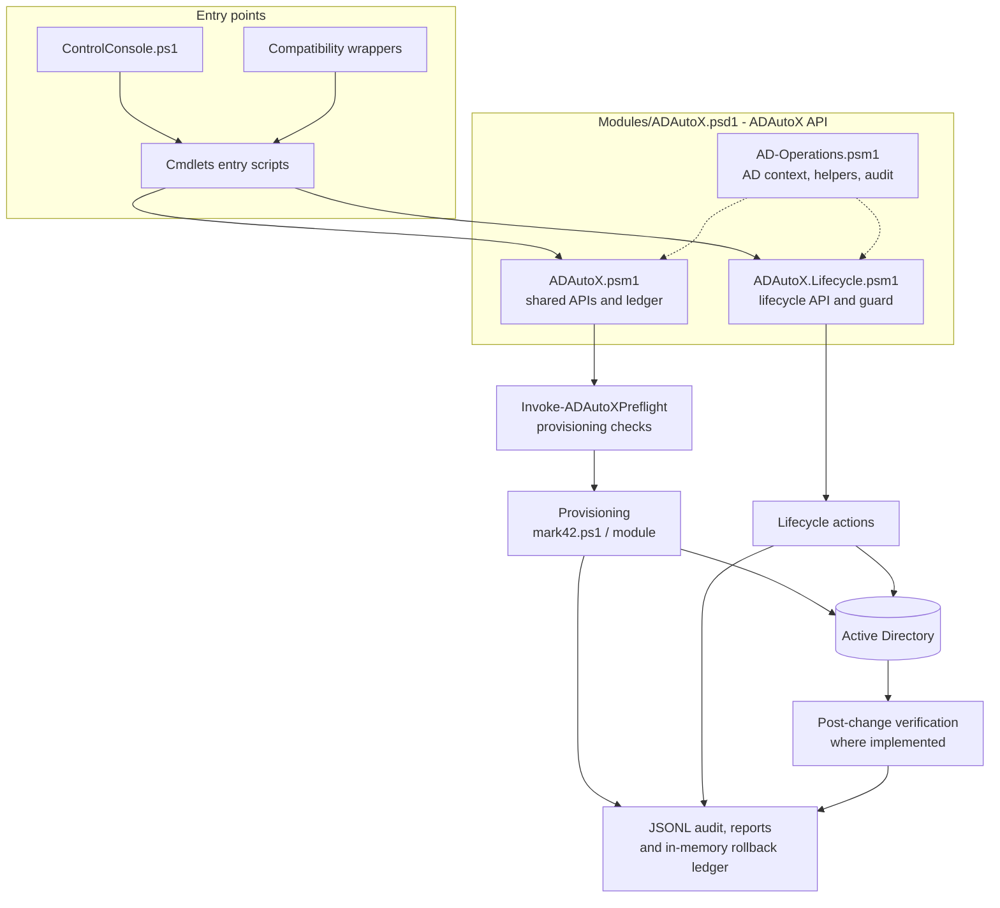
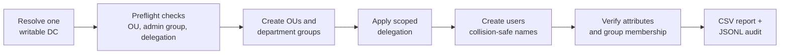

# AD_PS-automation: Technical and Operator Guide


This is the detailed operator and technical reference for **AD_PS-automation**. For a project overview and quick start, see [README.md](./README.md).

AD_PS-automation is a PowerShell toolkit that:

- provisions department-based Active Directory OU structures, groups, users, and scoped delegation;
- performs supported user lifecycle actions (enable, disable, unlock, move, reset password, terminate, delete, group changes);
- produces security, audit, and user reports.

A shared `ADAutoX` module centralizes the public API, provisioning preflight, lifecycle protections, verification, audit records, and rollback ledger. Command scripts provide canonical and backward-compatible entry points.

> **Intended scope.** This toolkit is built for lab, test, and controlled administrative use. Any use beyond a lab must go through your organization's change control and security review.

> **Testing status.** The toolkit is under active testing and the formal live-domain integration suite has **not yet been verified**. See [Testing and verification](#testing-and-verification) for the per-script status.

## Contents

- [Key capabilities](#key-capabilities)
- [Choosing a command](#choosing-a-command)
- [Architecture](#architecture)
- [Getting started](#getting-started)
- [Recommended change workflow](#recommended-change-workflow)
- [Provisioning](#provisioning)
- [User lifecycle management](#user-lifecycle-management)
- [Safety and security controls](#safety-and-security-controls)
- [Audit logging](#audit-logging)
- [Testing and verification](#testing-and-verification)
- [Known limitations](#known-limitations)
- [Cleanup](#cleanup)
- [Troubleshooting](#troubleshooting)
- [Reference](#reference)
- [Disclaimer](#disclaimer)

---

## Key capabilities

| Principle | What it means in practice |
| --- | --- |
| **Previewable** | Commands that declare `SupportsShouldProcess` support PowerShell's native `-WhatIf` and `-Confirm`. Check command help to confirm support. |
| **Gated** | High-impact operations require an explicit switch such as `-AllowDestructiveOperation`. Live cleanup also requires the exact target distinguished name (DN). |
| **Verified** | Operations with implemented post-change checks re-query AD to confirm outcomes such as group membership, enabled state, and password state. |
| **Auditable** | Provisioning and lifecycle commands write JSONL records for the actions they instrument, including failures and verification outcomes. |
| **Rerun-safe** | Existing matching identities are detected before creation, so repeating a run does not create duplicate or colliding accounts. |
| **Least privilege** | Department administrators receive narrowly scoped create/delete and read rights. Sensitive attribute writes are reserved for separately reviewed delegation. |
| **Reversible where possible** | Failed provisioning can be rolled back per run, and a session ledger can undo eligible lifecycle changes. |

## Choosing a command

| I want to... | Use |
| --- | --- |
| Provision departments, groups, and bulk users | [`mark42.ps1`](./Cmdlets/mark42.ps1) (canonical provisioner) |
| Create and verify a single user | [`New_User_Script.ps1`](./Cmdlets/New_User_Script.ps1) |
| Run any single-user lifecycle action | [`Manage-ADAutoXUser.ps1`](./Cmdlets/Manage-ADAutoXUser.ps1) (preferred adapter) |
| Add or remove a user from a group | `Script_Add_User_to_Group.ps1` / `Script_Remove_User_from_Group.ps1` |
| Find or unlock locked-out accounts | `Script_Find_Locked-Out_Users.ps1` / `Script_Unlock_User_Account.ps1` |
| Disable inactive accounts | `Script_Disable_Inactive_Users.ps1` |
| Review security posture | [`Get-ADAutoXSecurityScan.ps1`](./Cmdlets/Get-ADAutoXSecurityScan.ps1) or `Script_AD_Security_Report.ps1` |
| Review the audit trail | `Script_AD_Audit_Report.ps1` or [`Get-ADAutoXAuditReport.ps1`](./Cmdlets/Get-ADAutoXAuditReport.ps1) |
| Undo lifecycle changes from this session | [`Reset-ADAutoXEnvironment.ps1`](./Cmdlets/Reset-ADAutoXEnvironment.ps1) `-RollbackLedger` |
| Clean up a test OU | [`Remove-Test-Users.ps1`](./Cmdlets/Remove-Test-Users.ps1) |
| Work interactively from a menu | [`ControlConsole.ps1`](./Cmdlets/ControlConsole.ps1) |

---

## Architecture



### Design notes

- **One provisioning preflight.** `Invoke-ADAutoXPreflight` is the single implementation. The older `Test-ADProvisioningPreflight` entry point delegates to it. Lifecycle actions do **not** use it; they use their own target checks and protected-account guard.
- **Direct LDAP ACL access.** ACL reads and writes resolve the exact DN on the pinned domain controller and use the shared `DirectoryServices` LDAP helper. They do not depend on the `AD:` provider path.
- **Pending OUs.** Planned OUs that do not exist yet are reported as *pending creation* during preflight.
- **ACL diagnostics.** To troubleshoot a DC-specific ACL issue, run `.\Tests\Diagnose-ADAcl.ps1` from the repository root. Optional parameters: `-Server`, `-DistinguishedName`, `-Credential`.

### Repository layout

```text
AD_PS-automation/
├── Cmdlets/           Command scripts (mark42.ps1 is the canonical provisioner)
├── Modules/           ADAutoX.psd1 manifest and implementation modules
├── Data/              sample-names.txt
├── Tests/             validate_repo.ps1, Run-OfflineTests.ps1, Diagnose-ADAcl.ps1
├── docs/              Project and manual-test screenshots
├── README.md          Project overview, setup, safety, and command index
└── PROJECT_GUIDE.md   Detailed operational and technical reference (this file)
```

Run command scripts from the repository root using their `.\Cmdlets\...` paths.

### Compatibility wrappers

Legacy scripts preserve older command names or parameter interfaces and forward work to a canonical script or module function. They are adapters, not separate implementations.

> **Note:** `ActiveDirectory-Provisioner.ps1` and `Generate-ADUsers.ps1` keep legacy provisioning defaults. Review their parameter descriptions before use, and check command help because parameters and defaults can differ across wrappers. Use the `ADAutoX` module or the canonical `Cmdlets` commands for new automation.

| Legacy script | Forwards to |
| --- | --- |
| [`ActiveDirectory-Provisioner.ps1`](./Cmdlets/ActiveDirectory-Provisioner.ps1) | Canonical [`mark42.ps1`](./Cmdlets/mark42.ps1) |
| [`Generate-ADUsers.ps1`](./Cmdlets/Generate-ADUsers.ps1) | Canonical [`mark42.ps1`](./Cmdlets/mark42.ps1), with legacy defaults |
| [`Manage-ADAutoXUser.ps1`](./Cmdlets/Manage-ADAutoXUser.ps1) | `Invoke-ADAutoXUserAction` (`-AllowProtectedAccount` is forwarded for guarded actions) |
| [`Remove-Test-Users.ps1`](./Cmdlets/Remove-Test-Users.ps1) | [`2_RESET_TEST_USERS.ps1`](./Cmdlets/2_RESET_TEST_USERS.ps1) |
| [`Reset-ADAutoXEnvironment.ps1`](./Cmdlets/Reset-ADAutoXEnvironment.ps1) | `Invoke-ADAutoXLedgerRollback` with `-RollbackLedger`; otherwise [`Remove-Test-Users.ps1`](./Cmdlets/Remove-Test-Users.ps1) |
| [`Script_AD_Audit_Report.ps1`](./Cmdlets/Script_AD_Audit_Report.ps1) | `Get-ADAutoXAuditReport` |
| [`Script_AD_Security_Report.ps1`](./Cmdlets/Script_AD_Security_Report.ps1) | `Get-ADAutoXSecurityScan` |
| [`Script_Add_User_to_Group.ps1`](./Cmdlets/Script_Add_User_to_Group.ps1) | `Set-ADAutoXUserGroupMembership` (add action) |
| [`Script_Delete_User.ps1`](./Cmdlets/Script_Delete_User.ps1) | `Remove-ADAutoXUser` |
| [`Script_Disable_Inactive_Users.ps1`](./Cmdlets/Script_Disable_Inactive_Users.ps1) | `Disable-ADAutoXUser` when `-Identity` is supplied; otherwise `Disable-ADAutoXInactiveUsers` |
| [`Script_Disable_User.ps1`](./Cmdlets/Script_Disable_User.ps1) | `Disable-ADAutoXUser` |
| [`Script_Enable_User.ps1`](./Cmdlets/Script_Enable_User.ps1) | `Enable-ADAutoXUser` |
| [`Script_Find_Locked-Out_Users.ps1`](./Cmdlets/Script_Find_Locked-Out_Users.ps1) | `Get-ADAutoXLockedOutUsers` |
| [`Script_Move_User.ps1`](./Cmdlets/Script_Move_User.ps1) | `Move-ADAutoXUser` |
| [`Script_Remove_User_from_Group.ps1`](./Cmdlets/Script_Remove_User_from_Group.ps1) | `Set-ADAutoXUserGroupMembership` (remove action) |
| [`Script_Reset_User_Passwords.ps1`](./Cmdlets/Script_Reset_User_Passwords.ps1) | `Reset-ADAutoXUserPassword` |
| [`Script_Terminate_User.ps1`](./Cmdlets/Script_Terminate_User.ps1) | `Stop-ADAutoXUser` |
| [`Script_Unlock_User_Account.ps1`](./Cmdlets/Script_Unlock_User_Account.ps1) | `Unlock-ADAutoXUser` |

---

## Getting started

### Requirements

- Windows PowerShell 5.1 or PowerShell 7+
- The `ActiveDirectory` module (install RSAT if `Import-Module ActiveDirectory` fails)
- Network access to a writable domain controller
- An account with the delegated rights you intend to use
- A dedicated test OU and an approved change window

### First run

```powershell
# 1. From the repository root, confirm AD connectivity
Import-Module ActiveDirectory
Get-ADDomain

# 2. Preview guarded changes
.\Cmdlets\mark42.ps1 -AccountCount 5 -WhatIf

# 3. Preview an individual lifecycle action
.\Cmdlets\Manage-ADAutoXUser.ps1 -Identity 'jdoe' -Action Disable -AllowDestructiveOperation -WhatIf

# 4. Preview cleanup before deciding whether to apply it
.\Cmdlets\Remove-Test-Users.ps1 -OrganizationalUnitName 'Company' -WhatIf

# 5. Read-only audit review
.\Cmdlets\Script_AD_Audit_Report.ps1
```

To apply an approved change, rerun the reviewed command **without** `-WhatIf` and supply any required destructive-operation switch and exact target confirmation.

> **A preview is not an offline simulation.** Read-only Active Directory queries and preview audit records can still occur during `-WhatIf`.

### Choosing a domain controller

In multi-DC environments, pass `-Server <dc>` to select the writable DC. If omitted, one writable DC is resolved at startup and reused for the entire run, including verification and delegation changes.

## Recommended change workflow

1. **Preview** the command with `-WhatIf`.
2. **Test** on a small batch first.
3. **Confirm** the domain, OU path, and naming conventions.
4. **Apply** the reviewed command, adding any required destructive-operation switch.
5. **Review** the audit log and verification results.
6. **Follow change control** for anything beyond a lab.

---

## Provisioning

### How a run works



| Stage | What happens |
| --- | --- |
| **1. Preflight** | Resolves a writable DC, checks dependencies, validates department names and passwords, detects naming conflicts, and confirms existing groups have the expected scope and delegation. |
| **2. Provision** | Creates missing OUs, department groups, administrator accounts, standard accounts, memberships, and scoped delegation. Compatible existing resources are reused, not recreated. |
| **3. Verify** | Re-queries created accounts and checks department, UPN, OU, enabled state, required password change, and group membership. |
| **4. Report** | Prints a run summary and writes the CSV report and JSONL audit events. The report includes execution context: domain, forest, DC, operator, timestamp, PowerShell version, and OS. |

**Placement and naming**

- Standard users are assigned to departments round-robin and placed in the department's `Users` OU.
- Department administrator accounts are placed in its `Administrators` OU.
- Generated account names are checked against existing AD accounts and other names in the same run. A numeric suffix is added when needed.

**Stricter sequencing:** add `-EnableAccountsAfterVerification` to create accounts disabled, verify them, enable them, then verify again.

### Default OU layout

```text
Company
  Staff
    IT / HR / Finance / Sales        (default departments)
      Users
      Administrators
```

Use `-Departments` and `-OrganizationalUnitName` to change the layout, and `-CreateDepartmentAdministrators:$false` to skip administrator accounts.

### Delegation model

| Role | Can | Cannot |
| --- | --- | --- |
| `Department-Administrators` | Create and delete users in their department `Users` OU; list and read user objects there | Perform broad property writes |
| `Department-Attribute-Admins` | Reserved for explicitly reviewed attribute rights (currently granted nothing) | Reset passwords, enable/disable, unlock, or do anything not individually granted |
| Audit and report consumers | Read the JSONL log and reports | Should have read-only access only |

**Delegation rules**

- Administrator groups are validated by expected name, location, security category, Global scope, and SID.
- New delegation is granted only to a group **created during the current run**. A pre-existing group is accepted only if a SID-matched delegation entry already exists.
- Create/delete-child rights apply directly to the department `Users` OU. List/read rights are scoped separately to descendant user objects.

### Provisioning examples

```powershell
# Custom departments
.\Cmdlets\mark42.ps1 -AccountCount 20 -Departments 'Engineering','Support','Operations' -WhatIf

# Custom names file and OU name
.\Cmdlets\mark42.ps1 -NamesPath '.\custom-names.txt' -OrganizationalUnitName '_LAB-USERS' -WhatIf

# Administrators only, with generated names such as deptadmin-IT
.\Cmdlets\mark42.ps1 -AdministratorsOnly -AdministratorUsername 'deptadmin-{0}' -WhatIf

# Pin a DC and choose report and audit locations
.\Cmdlets\mark42.ps1 -AccountCount 10 -Server 'dc01.example.com' `
    -ReportPath '.\reports\provisioning.csv' -AuditLogPath '.\logs\operations.jsonl' -WhatIf

# One shared password, prompted securely
$securePassword = Read-Host 'Shared lab password' -AsSecureString
.\Cmdlets\mark42.ps1 -AccountCount 5 -Password $securePassword -WhatIf

# Opt-in DPAPI-protected credential export
.\Cmdlets\mark42.ps1 -AccountCount 5 -ExportPasswords -PasswordFile '.\user-passwords.clixml' -WhatIf
```

---

## User lifecycle management

Lifecycle commands resolve an identity by SAM account name or distinguished name, verify the outcome where supported, and restore shared AD context in a `finally` block.

**Disable, terminate, delete, and group-removal actions require `-AllowDestructiveOperation`** in addition to preview and confirmation.

```powershell
# Preview a disable
.\Cmdlets\Manage-ADAutoXUser.ps1 -Identity 'jdoe' -Action Disable -AllowDestructiveOperation -WhatIf

# Preview a move and a termination
.\Cmdlets\Manage-ADAutoXUser.ps1 -Identity 'jdoe' -Action Move `
    -TargetOU 'OU=Users,OU=HR,OU=Staff,OU=Company,DC=example,DC=com' -WhatIf
.\Cmdlets\Manage-ADAutoXUser.ps1 -Identity 'jdoe' -Action Terminate `
    -Reason 'Employment ended' -TargetOU 'OU=Disabled,OU=Company,DC=example,DC=com' `
    -AllowDestructiveOperation -WhatIf

# Find and clear locked accounts, then scan for risky accounts
.\Cmdlets\Script_Find_Locked-Out_Users.ps1 -CsvPath '.\reports\locked.csv'
.\Cmdlets\Script_Unlock_User_Account.ps1 -Identity 'jdoe' -WhatIf
.\Cmdlets\Get-ADAutoXSecurityScan.ps1 -InactiveDays 90
```

> **Locked-out discovery.** Accounts are found with `Search-ADAccount -LockedOut -UsersOnly`, then retrieved with `Get-ADUser` for the properties each report needs. `LockedOut` is computed by Active Directory and is not supported in a `Get-ADUser -Filter` expression.

### The ADAutoX module

`Modules\ADAutoX.psd1` is the supported module entry point. Import it once to use the shared provisioning, lifecycle, context, credential-export, and audit functions.

```powershell
Import-Module .\Modules\ADAutoX.psd1
Get-Command -Module ADAutoX

Invoke-ADAutoXProvision -AccountCount 5 -WhatIf
Move-ADAutoXUser -Identity 'jdoe' -TargetPath 'OU=Users,OU=IT,OU=Staff,OU=Company,DC=example,DC=com' -WhatIf
Disable-ADAutoXUser -Identity 'jdoe' -AllowDestructiveOperation -WhatIf
```

- `Terminate-ADAutoXUser` remains available as a compatibility alias for `Stop-ADAutoXUser`.
- `Manage-ADAutoXUser` remains an alias for `Invoke-ADAutoXUserAction`.
- Module imports resolve relative to the importing script, so the repository can be cloned anywhere.

### Rollback ledger

Successful reversible lifecycle changes are recorded in a **session-scoped ledger**:

- enablement state
- moves
- direct group membership
- termination descriptions
- department and company updates

**How rollback behaves**

- It verifies each object still has the state produced by the recorded change before restoring it, so later changes are not overwritten.
- Lifecycle entries are processed newest-first.
- Created resources are removed in dependency order: users, delegation, groups, then deepest OUs.
- Entries are removed from the ledger after successful rollback processing.

```powershell
# Review pending entries, then preview the reversal in the same session
Get-ADAutoXLedger
.\Cmdlets\Reset-ADAutoXEnvironment.ps1 -RollbackLedger `
    -ExpectedDistinguishedName 'OU=Company,DC=example,DC=com' -WhatIf
```

`Add-ADAutoXLedgerEntry` is the shared writer for resource and lifecycle entries. `Invoke-ADAutoXLedgerRollback` handles eligible OU, group, user, delegation, and lifecycle undo entries.

**Rollback cannot restore** password resets, unlocks, or deletions, and it never deletes the environment OU. The ledger exists only in the current PowerShell session.

---

## Safety and security controls

### Before a change

| Control | Behavior |
| --- | --- |
| **Single preflight** | `Invoke-ADAutoXPreflight` performs non-mutating dependency, domain, input, OU, group, and delegation checks for the requested provisioning run. Lifecycle commands validate their targets separately and do not run it. |
| **Protected-account guard** | Applicable lifecycle actions refuse accounts with `AdminCount = 1`, membership in configured protected groups, `IsCriticalSystemObject = $true`, built-in SAM names (`Administrator`, `Guest`, `krbtgt`), or the account running the script. Accidental-deletion protection is checked for termination and deletion. |
| **Protected-account bypass** | An explicit `-AllowProtectedAccount` logs a warning and an audit entry. Use it only with specific approval; it is not a substitute for reviewing the target and the change. |
| **`-WhatIf` / `-Confirm`** | Available on commands that declare `SupportsShouldProcess`. Read-only AD queries and preflight checks may still run. Check command help rather than assuming every script supports these parameters. |
| **Pinned `AD:` drive** | The tools create `AD:` for the selected DC and refuse an unowned pre-existing `AD:` drive whose server cannot be verified. Where the ActiveDirectory module auto-mounts that drive, remove it before starting in a clean session. ACL paths retain the DN and escape provider path separators. |
| **Cleanup guards** | Cleanup refuses protected built-in targets (such as `Domain Controllers`), checks the exact target DN before live deletion, and processes descendants before parents. |
| **Bulk scan guard** | Domain-wide inactivity scans require `-AllowDomainWide`. |

### Rollback options

| Option | Scope |
| --- | --- |
| Unified ledger | `Add-ADAutoXLedgerEntry` records run-created OUs, groups, users, exact delegation entries, and supported reversible lifecycle changes. `Invoke-ADAutoXLedgerRollback` processes eligible entries after checking current state, undoing lifecycle entries before created resources. |
| `-RollbackCreatedAccountsOnFailure` (aliases `-RollbackOnFailure`, `-RollbackAccountsOnFailure`) | Removes only accounts created by the current run. |
| `-RollbackCreatedResourcesOnFailure` (ADAutoX provisioning adapter) | Also attempts to remove run-created groups, the exact delegation entries added by the run, and empty OUs carrying the provisioner marker. Never deletes an OU recursively; pre-existing resources are kept. |

Rollback is best-effort. Always verify the directory and logs afterwards.

### Credential handling

- **Default:** passwords are generated randomly per account and are **not** stored.
- **`-ExportPasswords`:** writes a DPAPI-protected CLIXML export on Windows. The staged file is ACL-restricted to the current Windows identity before publication, and an existing destination is not replaced without `-OverwritePasswordFile`. This is **not a credential vault**: restrict access and set a retention policy.
- **`-IncludePasswordInReport`:** writes **plaintext** passwords to the CSV. Use only for a specific, approved, short-lived need, and delete the report promptly.
- Keep plaintext credentials out of scripts, shell history, and shared folders.

### Operational practice

- Audit logs and reports contain operator, machine, account, and OU data. Keep them local, access-controlled, and out of version control.
- Use a dedicated test OU, and confirm the domain, OU path, and naming before any live run.
- Provisioning reuses matching existing OUs and groups. On retry, delegation may be granted to an existing administrator group only if the JSONL audit log contains a successful `CreateGroup` record for that exact group DN. Otherwise the pre-existing-group safety guard still refuses the grant.

---

## Audit logging

Records are written as JSON Lines to `AD-Operations.jsonl` by default (or the path in `-AuditLogPath`) for instrumented provisioning and lifecycle actions. Coverage is per command and action; do not assume every read or mutation is logged.

**Fields:** `Timestamp`, `Actor`, `Computer`, `Action`, `Target`, `TargetType`, `Status`, `Message`, `Details`, `Source`, `CorrelationId`

```powershell
.\Cmdlets\Script_AD_Audit_Report.ps1                                        # summary
.\Cmdlets\Script_AD_Audit_Report.ps1 -Identity 'jdoe'                       # one identity
.\Cmdlets\Script_AD_Audit_Report.ps1 -Action 'CreateUser' -Status 'Failed'  # filtered
.\Cmdlets\Get-ADAutoXAuditReport.ps1 -Status 'Failed'                       # module-based report
```

Both report scripts share the same parser and filters. The legacy script keeps its summary and JSON output and its strict handling of malformed records.

**Interpreting status values**

- Previews and declined confirmations are logged differently from attempted changes.
- `CompletedWithErrors` means a change was attempted but a later step failed. **Inspect the target object before retrying**, because part of the change may already have taken effect.

---

## Testing and verification

### Manual test status

| Script | Status | Evidence |
| --- | --- | --- |
| `mark42.ps1` | Tested successfully in the lab | Manual lab run |
| `Script_Terminate_User.ps1` | Tested successfully in the lab | `-WhatIf` preview followed by an approved run; the ledger reported restoration entries for the account's enabled state and description |
| `Script_Reset_User_Passwords.ps1` | Successful operations against a real AD domain | Manual test |
| `Script_Move_User.ps1` | Successful operations against a real AD domain | Reported `Succeeded` |
| `Script_Enable_User.ps1` | Successful operations against a real AD domain | Reported `Succeeded` |
| `Script_Disable_User.ps1` | Exercised against real AD | Screenshots show the destructive-operation guard and `-WhatIf` preview; a completed live disable is not shown |
| `Script_Delete_User.ps1` | Exercised against real AD | Screenshots show the destructive-operation guard and `-WhatIf` preview; a completed live deletion is not shown |
| Remaining scripts | Testing in progress | None yet |
| Formal live-domain integration suite | **Not yet verified** | None yet |

See the redacted [test screenshots](./README.md#testing-and-verification).

### Offline checks

These checks need no AD connection and make no changes to Active Directory. Run them from the repository root in Windows PowerShell 5.1 or PowerShell 7.

```powershell
.\Tests\validate_repo.ps1      # parses every .ps1 and .psm1; exits nonzero on parser errors
.\Tests\Run-OfflineTests.ps1   # offline regression suite

# Or explicitly:
powershell.exe -NoProfile -File .\Tests\Run-OfflineTests.ps1
```

The offline suite exercises pure helpers and checks implementation wiring and safety contracts without connecting to AD or faking AD responses. It covers:

- LDAP/DN escaping, identity and error classification
- inactivity cutoffs and termination notes
- safe file publishing and credential-export guards
- wrapper forwarding and rollback
- audit filtering and correlation IDs
- lifecycle ledger behavior
- provisioning, name handling, and password generation and patterns
- context cleanup, group validation, and delegated ACL scope

**Not covered:** AD provider behavior, Windows ACL enforcement, permissions, replication, domain policy, and live rollback. Verify these in an authorized lab with a writable DC and a dedicated test OU.

### Live integration suite (opt-in)

`Run-ADIntegrationTests.ps1` is separate from the offline suite and requires `-RunLive`. It is intended **only for a disposable test domain**.

```powershell
.\Tests\Run-ADIntegrationTests.ps1 -RunLive -ExpectedDomainDnsRoot 'lab.example.test'
```

What it does:

- securely prompts for a temporary password;
- verifies the connected domain matches the supplied DNS root **before** making changes;
- provisions uniquely named test resources;
- rolls back only the entries created by that test run.

Prerequisites: a writable DC and sufficient OU, group, and delegation rights. The test stops if the current session ledger is not empty.

---

## Known limitations

| Limitation | Detail |
| --- | --- |
| **Canonical rollback is account-only** | `mark42.ps1 -RollbackCreatedAccountsOnFailure` removes accounts created by the run. Guarded resource cleanup is available through the ADAutoX adapter's `-RollbackOnFailure`; non-empty or unmarked OUs are left in place. |
| **Batches continue after a single failure** | The canonical rollback removes only the failing account. The ADAutoX adapter lets the batch finish, then rolls back all run-created resources if anything failed. Unexpected run-level failures trigger rollback immediately. |
| **Ledger is in memory** | It does not survive a PowerShell restart. |
| **`Department-Attribute-Admins` is a placeholder** | The group is created but granted no rights until you add reviewed ones. |
| **Windows only** | Credential export and ACL handling require Windows. |
| **Inactivity data is approximate** | `LastLogonDate` comes from the replicated `lastLogonTimestamp` and can lag by up to 14 days. |

---

## Cleanup

Live cleanup requires `-ExpectedDistinguishedName` to match, exactly, the target OU DN printed by the `-WhatIf` preview. Replace the example domain with the DN from your own preview.

```powershell
# Previews only
.\Cmdlets\Remove-Test-Users.ps1 -OrganizationalUnitName 'Company' -WhatIf
.\Cmdlets\Remove-Test-Users.ps1 -OrganizationalUnitName 'Company' -RemoveAllObjects `
    -RemoveOrganizationalUnit -WhatIf
.\Cmdlets\Remove-Test-Users.ps1 -OrganizationalUnitName 'Company' -DeleteEverything -WhatIf
```

After reviewing the preview and confirming the exact DN, rerun the approved command without `-WhatIf`, adding the required destructive-operation switch and `-ExpectedDistinguishedName`.

---

## Troubleshooting

| Symptom | What to check |
| --- | --- |
| AD module unavailable | Run `Get-Module -ListAvailable ActiveDirectory`, then install RSAT and `Import-Module ActiveDirectory`. |
| Access denied | Confirm the account's delegated rights and that the target DC is reachable. |
| Names file not found | Confirm the custom `-NamesPath` exists. The default is `Data\sample-names.txt`. |
| User creation fails | Read the emitted failure details. Usual causes: naming collisions, password-policy violations, missing permissions, DC reachability, or conflicting existing objects. |
| "The specified group already exists" on user creation | The requested SAM account name is already used by a group. Users and groups share one SAM namespace; choose a different logon name. |
| Password rejected | The password does not meet the domain's length, complexity, or history requirements. Check `Get-ADDefaultDomainPasswordPolicy`. |
| "A user ... already exists" | The user is already present. Verify with `Get-ADUser <name>` before creating again. |
| `Get-ADGroup` cannot find an identity | `-Identity` matches DN, GUID, SID, or SAM account name only. Use the exact group name, for example `HR-Users` rather than `HR`. |

---

## Reference

Details for every script, parameter, and module. Expand a section to view it.

<details>
<summary><strong><code>mark42.ps1</code> parameters</strong></summary>

&nbsp;

A default live run requests 20 standard users, creates department administrator accounts, and writes the CSV report and JSONL audit log at the repository root. Relative paths you supply resolve from the PowerShell location where you run the command; built-in defaults are based on the repository location.

| Parameter | Default | Description |
| --- | --- | --- |
| `-AccountCount` | `20` | Standard users to request (0–1000). `0` means every valid name in the names file; if fewer valid names exist, the count is reduced with a warning. |
| `-OrganizationalUnitName` | `Company` | Top-level OU created beneath the domain root. |
| `-StaffNamesOrganizationalUnitName` | `Staff` | OU beneath the top-level OU that holds department OUs. |
| `-Departments` | `IT`, `HR`, `Finance`, `Sales` | Departments to provision, assigned round-robin. Names are validated first. |
| `-NamesPath` | `Data\sample-names.txt` | UTF-8 names file. Each nonblank line is a first name followed by a surname. |
| `-AdministratorsOnly` | Off | Provision only department administrator OUs, groups, and accounts; skips the names file. |
| `-CreateDepartmentAdministrators` | On | Create an administrator account and groups per department. Pass `:$false` to opt out. |
| `-AdministratorUsername` | `<department>.admin` | Administrator SAM-account-name template. Use `{0}` for the department name, e.g. `deptadmin-{0}`. Required when one custom base name spans several departments. |
| `-Password` | Random per account | Optional `SecureString` shared by all accounts in the run. Takes precedence over patterns. |
| `-PasswordPattern` | None | Per-account pattern for standard users. `{0}` is the username; `{1}`/`{2}` are the one-based account token. Escape literal braces as `{{` and `}}`. Preflight checks are best-effort; AD enforces the real policy at creation. |
| `-AdministratorPasswordPattern` | None | Pattern for department administrators. `{0}` is the administrator username (`{1}`/`{2}` also resolve to it). |
| `-EnableAccountsAfterVerification` | Off | Create accounts disabled, verify attributes and memberships, then enable and re-verify. |
| `-Server` | Auto-resolved | Domain controller to use; one writable DC is reused for the whole run. |
| `-Credential` | Current context | `PSCredential` for AD operations. |
| `-UPNSuffix` | Domain DNS root | UPN suffix for created accounts. |
| `-ReportPath` | `AD-Provisioning-Report.csv` at repo root | UTF-8 CSV destination; parent folders are created. |
| `-AuditLogPath` | `AD-Operations.jsonl` at repo root | JSONL audit destination. |
| `-CorrelationId` | New GUID | ID that ties this run's audit records together. |
| `-RollbackCreatedAccountsOnFailure` | Off | Remove accounts created by this run when verification or membership fails. |
| `-RollbackCreatedResourcesOnFailure` | Off | Guarded rollback of run-created accounts, groups, exact delegation entries, and empty provisioner-marked OUs. |
| `-ExportPasswords` | Off | Opt in to the DPAPI-protected CLIXML credential export. |
| `-PasswordFile` | `user-passwords.clixml` when exporting | Export destination. Error if given without `-ExportPasswords`. |
| `-OverwritePasswordFile` | Off | Allow replacing an existing export. |
| `-IncludePasswordInReport` | Off | Add **plaintext** passwords to the CSV. See [Credential handling](#credential-handling). |
| `-WhatIf` / `-Confirm` / `-Verbose` | n/a | Standard PowerShell preview, confirmation, and diagnostic output. |

**Hidden compatibility parameters.** `-TreatZeroAccountCountAsNone` and `-DisableDepartmentAdministratorsByDefault` exist for the wrapper scripts and are not meant for direct use.

**`-AccountCount 0` semantics differ by script:**

- `mark42.ps1`: every valid name in the names file.
- `Generate-ADUsers.ps1`: no standard users (legacy meaning), and administrator creation is opt-in.

`ActiveDirectory-Provisioner.ps1` requires an explicit `-PasswordFile` for credential export.

**CSV report contents.** Domain, forest, DC, operator, computer, PowerShell version, run time, and per-account username, name, department, role, target OU, status, stage, timestamp, and error details. A password column exists only with `-IncludePasswordInReport`. Run status distinguishes preview, success, skipped, failed, and partial outcomes, so check the report and audit log before retrying a partial run.

</details>

<details>
<summary><strong>Script reference</strong></summary>

&nbsp;

Run from the repository root. Most AD commands also accept `-Server`, `-Credential`, and `-AuditLogPath`. A command supports `-WhatIf` only where it declares it. All `Script_*.ps1` files live in [`Cmdlets/`](./Cmdlets).

**Provisioning and users**

| Script | Purpose | Key inputs |
| --- | --- | --- |
| [`mark42.ps1`](./Cmdlets/mark42.ps1) | Canonical bulk provisioner | See the parameter table above |
| [`ActiveDirectory-Provisioner.ps1`](./Cmdlets/ActiveDirectory-Provisioner.ps1) | Legacy-interface wrapper around `mark42.ps1` | Same provisioning inputs; credential export needs `-PasswordFile` |
| [`Generate-ADUsers.ps1`](./Cmdlets/Generate-ADUsers.ps1) | Legacy generator wrapper keeping older defaults | Similar to `mark42.ps1`; `-AccountCount 0` means no standard users |
| [`Invoke-ADAutoXProvision.ps1`](./Cmdlets/Invoke-ADAutoXProvision.ps1) | Module-backed provisioning adapter | `-CompanyOuName`, `-StaffOuName`, `-RollbackOnFailure`, plus the common provisioning options |
| [`New_User_Script.ps1`](./Cmdlets/New_User_Script.ps1) | Create and verify one user | Required: `-GivenName`, `-Surname`, `-SamAccountName`, `-Path`. Optional: `-UserPrincipalName`, secure `-Password`, `-Department`, `-Title`, `-Description`, `-Disabled`, `-NoChangePasswordAtLogon`. Rejects duplicate SAM/UPN values and never silently deletes a user whose verification failed |
| [`ControlConsole.ps1`](./Cmdlets/ControlConsole.ps1) | Interactive menu: provisioning, audit review, security scan, user management, reset preview, offline tests | No parameters. Passwords are collected as `SecureString`; destructive flows need typed confirmation |

**Export and cleanup**

| Script | Purpose | Key inputs |
| --- | --- | --- |
| [`Export-Test-Users.ps1`](./Cmdlets/Export-Test-Users.ps1) | CSV snapshot of users under an OU | `-OrganizationalUnitName` (default `Company`), `-OutputPath`, `-IncludeGroupMembership`. CSV text is escaped against spreadsheet formula injection |
| [`Remove-Test-Users.ps1`](./Cmdlets/Remove-Test-Users.ps1) | Friendly cleanup wrapper | `-RemoveOrganizationalUnit`, `-RemoveAllObjects`, `-DeleteEverything`. Live runs need `-AllowDestructiveOperation` and `-ExpectedDistinguishedName`. `-Force` skips per-object prompts only |
| [`2_RESET_TEST_USERS.ps1`](./Cmdlets/2_RESET_TEST_USERS.ps1) | Performs the scoped cleanup | Same switches; `-RemoveAllObjects` requires `-RemoveOrganizationalUnit`; `-DeleteEverything` implies both |
| [`Reset-ADAutoXEnvironment.ps1`](./Cmdlets/Reset-ADAutoXEnvironment.ps1) | Reverts the session ledger or forwards to guarded cleanup | `-RollbackLedger` with `-ExpectedDistinguishedName`; otherwise `-CompanyOuName` and the cleanup safety switches |

**User lifecycle and groups**

| Script | Purpose | Key inputs |
| --- | --- | --- |
| [`Manage-ADAutoXUser.ps1`](./Cmdlets/Manage-ADAutoXUser.ps1) | Preferred adapter | `-Identity`, `-Action` (`Disable`, `Enable`, `Unlock`, `Move`, `RemoveFromGroup`, `ResetPassword`, `Terminate`), optional `-TargetOU`, `-Group`, `-Reason`, secure `-NewPassword`, `-MustChangeAtLogon`, `-AllowProtectedAccount` |
| [`Invoke-ADAutoXUserLifecycle.ps1`](./Cmdlets/Invoke-ADAutoXUserLifecycle.ps1) | General dispatcher | `-Action` (adds `Delete` and `AddToGroup`), `-Identity`, `-TargetPath`, `-Group`, `-Reason`, `-AllowProtectedAccount` |
| `Script_Enable_User.ps1`, `Script_Unlock_User_Account.ps1` | Enable or unlock one account | `-Identity` |
| `Script_Disable_User.ps1`, `Script_Delete_User.ps1` | Disable or delete one account | `-Identity`, `-AllowDestructiveOperation`, optional `-AllowProtectedAccount` |
| `Script_Terminate_User.ps1` | Disable, optionally move to `-TerminationOU`, and append `-TerminationReason` to the description | `-Identity`, `-AllowDestructiveOperation`, optional `-AllowProtectedAccount`. Existing description text is kept and length is checked |
| `Script_Move_User.ps1` | Move one account | `-Identity`, `-TargetPath`, optional `-AllowProtectedAccount` |
| `Script_Add_User_to_Group.ps1`, `Script_Remove_User_from_Group.ps1` | Change group membership (verified) | `-Identity`, `-Group`, optional `-AllowProtectedAccount`; removal also needs `-AllowDestructiveOperation` |
| `Script_Reset_User_Passwords.ps1` | Set a password | `-Identity`, secure `-NewPassword`, `-MustChangeAtLogon`, optional `-AllowProtectedAccount` |

**Account health and reporting**

| Script | Purpose | Key inputs |
| --- | --- | --- |
| `Script_Disable_Inactive_Users.ps1`, [`Disable-ADAutoXInactiveUsers.ps1`](./Cmdlets/Disable-ADAutoXInactiveUsers.ps1) | Disable one account or run the bulk inactivity workflow | `-InactiveDays` (default 90, range 1–3650), `-SearchBase`, `-IncludeNeverLoggedOn`, `-CsvPath`. Domain-wide scans need `-AllowDomainWide`; applying needs `-AllowDestructiveOperation`; optional `-AllowProtectedAccount` |
| `Script_Find_Locked-Out_Users.ps1`, [`Get-ADAutoXLockedOutUsers.ps1`](./Cmdlets/Get-ADAutoXLockedOutUsers.ps1) | Find locked-out accounts | `-SearchBase`, `-CsvPath` |
| [`Get-ADAutoXSecurityScan.ps1`](./Cmdlets/Get-ADAutoXSecurityScan.ps1) | Structured posture scan: locked-out, password-never-expires, inactive | `-SearchBase`, `-InactiveDays`. Read-only |
| `Script_AD_Security_Report.ps1` | Human-readable security summary, including privileged users and department administrator counts | `-SearchBase`, `-DomainName`, `-Departments`, `-OrganizationalUnitName`. Without `-SearchBase` it falls back to a domain-wide scan, so set a scope deliberately |
| [`Update-ADAutoXUserDepartments.ps1`](./Cmdlets/Update-ADAutoXUserDepartments.ps1) | Derive department attributes from the OU layout | Required `-SearchBase`; `-CompanyName` (default `Company`). Supports `-WhatIf` |
| `Script_AD_Audit_Report.ps1` | Read-only JSONL audit summary and timeline (no AD connection needed) | `-AuditLogPath`, `-Identity`, `-Action`, `-Status` (`Started`, `Succeeded`, `Failed`, `Skipped`, `Preview`, `CompletedWithErrors`), `-OutputPath`, `-AsJson` |
| [`Get-ADAutoXAuditReport.ps1`](./Cmdlets/Get-ADAutoXAuditReport.ps1) | Module-based audit filter and CSV export | Adds `-Actor` to the filters above |

</details>

<details>
<summary><strong>Module API</strong></summary>

&nbsp;

Import the manifest rather than the implementation files. It requires PowerShell 5.1 or later, loads the implementation modules, exports the public functions, and provides `Terminate-ADAutoXUser` as an alias for `Stop-ADAutoXUser`. Use `Get-Command -Module ADAutoX` for the exact exported names.

| Module file | Responsibility |
| --- | --- |
| [`ADAutoX.psd1`](./Modules/ADAutoX.psd1) | Supported manifest: minimum PowerShell version, function and alias exports |
| [`ADAutoX.psm1`](./Modules/ADAutoX.psm1) | Loader and facade: provisioning, lifecycle entry points, security scan, audit report, context and preflight, rollback ledger, password/identity/LDAP/ACL/credential/log helpers |
| [`ADAutoX.Lifecycle.psm1`](./Modules/ADAutoX.Lifecycle.psm1) | Shared lifecycle dispatcher and guarded actions (enable, disable, unlock, reset, move, terminate, delete, group changes), inactivity and locked-out workflows, department updates, audit and ledger support |
| [`AD-Operations.psm1`](./Modules/AD-Operations.psm1) | AD module loading, server/credential context with restoration, safe identity and OU resolution, LDAP/DN escaping, preflight checks, secure file publishing, CSV helpers, structured audit output |
| [`AD-Provisioning.psm1`](./Modules/AD-Provisioning.psm1) | Provisioning validation, password generation and patterns, collision-safe names, OU/group/user creation and verification, delegation, reports, rollback helpers |

</details>

---

## Disclaimer

Outside `-WhatIf`, these scripts make **real changes** to Active Directory: creating accounts, resetting passwords, changing group membership, and deleting objects. Use them only where you are authorized, and follow the [recommended change workflow](#recommended-change-workflow): preview, test small, confirm the domain and OU, review the audit log, and follow change control for anything beyond a lab.

For the project overview, setup instructions, and command index, see [README.md](./README.md).
