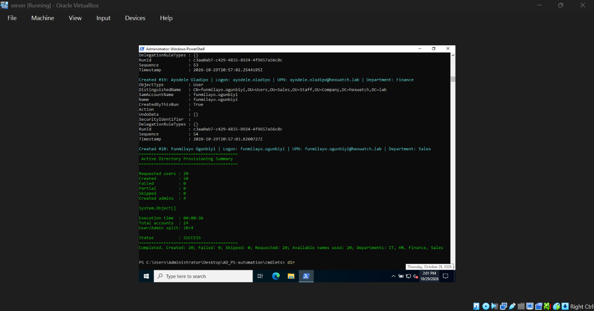

# AD_PS-automation

PowerShell-based Active Directory automation toolkit for provisioning, lifecycle management, and security auditing in lab and test environments.



## Overview
I developed this PowerShell toolkit to make Active Directory administration more consistent, efficient, and safe. It automates department-based provisioning and common user lifecycle tasks, applies scoped delegation, and provides audit and security reporting. Preflight validation, change previews, protected-account safeguards, and rollback support help reduce manual effort and operational risk.

## What it does
- Provisions AD users, groups, and organizational units in a controlled and repeatable way
- Manages lifecycle actions such as enable, disable, unlock, move, reset password, and terminate
- Applies least-privilege delegation for department administrators
- Records complete change activity to a JSONL audit log for traceability
- Uses preflight checks, `-WhatIf` / `-Confirm`, and rollback logic to make changes safer and easier to retry
- Produces security and audit reports for operational review

## Why this project matters
This project helps reduce time spent on manual AD tasks, standardizes onboarding across departments, and minimizes configuration drift, accidental changes, and operational risk. It is designed for controlled administrative use and is safer than ad hoc scripting in production-style environments.

## Testing status
The Mark 42 provisioning script and `Script_Terminate_User.ps1` have been tested successfully in the lab. The termination run included a `-WhatIf` preview followed by an approved run; testing of the remaining scripts is in progress.

## Key components
- `Cmdlets/mark42.ps1` — primary provisioning script
- `Cmdlets/Manage-ADAutoXUser.ps1` — lifecycle actions for user management
- `Modules/ADAutoX.psd1` — supported module entry point
- `Tests/` — validation and diagnostic scripts

## Quick start
```powershell
Import-Module ActiveDirectory
Get-ADDomain

# Preview a provisioning run
.\Cmdlets\mark42.ps1 -WhatIf

# Preview a lifecycle action
.\Cmdlets\Manage-ADAutoXUser.ps1 -Identity 'jdoe' -Action Disable -WhatIf
```

## Safety and governance
- Preflight validation before provisioning changes
- Explicit approval required for high-impact actions
- Preview and confirmation support for safer operations
- Structured logs for audit and review
- Protected-account safeguards and destructive-operation checks

## Best fit
This project is ideal for:
- Active Directory administrators
- IT automation engineers
- Lab and test environment management
- Departmental user provisioning and lifecycle automation

> Scope: designed for lab/test and controlled administrative use. Production changes should follow formal change control and security review.

For the full technical documentation, see the [Project Guide](./PROJECT_GUIDE.md).
