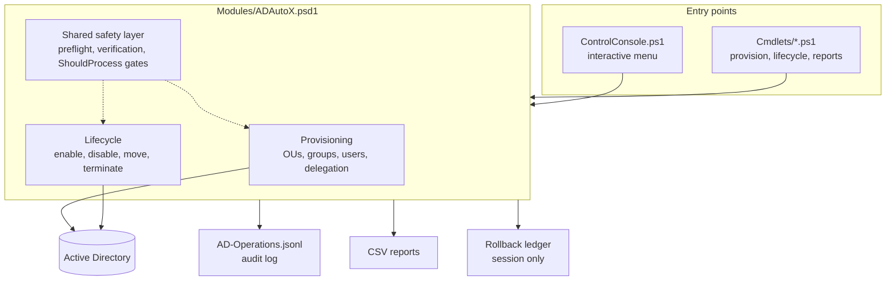
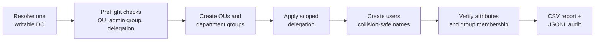

# AD_PS-automation


**Safety-first PowerShell automation for Active Directory: provisioning, user lifecycle administration, and audit reporting.**

AD_PS-automation builds a department-based OU structure with scoped delegation, bulk-provisions test users, and runs lifecycle operations (enable, disable, move, terminate, delete, unlock, password reset, group changes). Every change can be previewed with `-WhatIf`, destructive actions need an explicit opt-in, results are re-queried from AD to confirm they took effect, and instrumented actions are written to a structured JSONL audit log. The `ADAutoX` module exposes the same functionality as a reusable PowerShell API.

> **Scope:** built for lab, test, and controlled administrative use. Anything beyond a lab should go through your organization's change control and security review.

<!-- Add a terminal screenshot or short demo GIF here, for example:

-->

[Highlights](#highlights) · [Architecture](#architecture) · [Quick start](#quick-start) · [Provisioning](#how-a-provisioning-run-works) · [Lifecycle](#user-lifecycle) · [Safety](#safety-model) · [Audit](#audit-logging) · [Testing](#testing) · [Reference](#reference)

## Highlights

| Principle | What it means in practice |
| --- | --- |
| **Previewable** | Mutating commands use PowerShell's native `-WhatIf` / `-Confirm` (`ShouldProcess`). There is no custom dry-run flag to learn. |
| **Gated** | Destructive operations need an explicit switch such as `-AllowDestructiveOperation`, and live cleanup also needs the exact target DN. |
| **Verified** | Scripts re-query AD after a change (group membership, enabled state, password state) instead of trusting a cmdlet that returned without error. |
| **Auditable** | Provisioning and lifecycle commands write JSONL records for the actions they instrument, including failures and verification outcomes. |
| **Rerun-safe** | Existing matching identities are detected before creation, so repeating a run does not create duplicate or colliding accounts. |
| **Least privilege** | Department administrators get narrowly scoped create/delete and read rights; sensitive attribute writes are reserved for separately reviewed delegation. |
| **Reversible where possible** | Run-scoped rollback for failed provisioning, plus a session ledger that can undo eligible lifecycle changes. |

## Architecture



```text
AD_PS-automation/
├── Cmdlets/   command scripts (mark42.ps1 is the canonical provisioner)
├── Modules/   ADAutoX.psd1 manifest and implementation modules
├── Data/      sample-names.txt
├── Tests/     validate_repo.ps1, Run-OfflineTests.ps1
└── README.md
```

Run command scripts from the repository root using their `.\Cmdlets\...` paths. `mark42.ps1` is the canonical bulk provisioner; `ActiveDirectory-Provisioner.ps1` and `Generate-ADUsers.ps1` keep their older command-line interfaces as thin wrappers, so provisioning fixes live in one implementation.

## Quick start

**Requirements**

- Windows PowerShell 5.1 or PowerShell 7+
- The `ActiveDirectory` module (install RSAT if `Import-Module ActiveDirectory` fails)
- Network access to a writable domain controller
- An account with the delegated rights you intend to use
- A dedicated test OU and an approved change window

**Run it**

```powershell
# 1. From the repository root, confirm AD connectivity
Import-Module ActiveDirectory
Get-ADDomain

# 2. Preview (no changes; may still run read-only AD queries)
.\Cmdlets\mark42.ps1 -AccountCount 5 -WhatIf

# 3. Create test users
.\Cmdlets\mark42.ps1 -AccountCount 5

# 4. Snapshot what was created
.\Cmdlets\Export-Test-Users.ps1 -OrganizationalUnitName 'Company'

# 5. Review the audit trail
.\Cmdlets\Script_AD_Audit_Report.ps1

# 6. Clean up (preview first, then apply with the exact DN shown by the preview)
.\Cmdlets\Remove-Test-Users.ps1 -OrganizationalUnitName 'Company' -WhatIf
.\Cmdlets\Remove-Test-Users.ps1 -OrganizationalUnitName 'Company' -AllowDestructiveOperation `
    -ExpectedDistinguishedName 'OU=Company,DC=example,DC=com'
```

In multi-DC environments, pass `-Server <dc>` to choose the writable DC. If you omit it, one writable DC is resolved at startup and reused for the whole run, including verification and delegation changes.

## How a provisioning run works



1. **Preflight:** resolves a writable DC, checks dependencies, validates department names and passwords, detects naming conflicts, and checks that existing groups have the expected scope and delegation.
2. **Provision:** creates missing OUs, department groups, administrator accounts, standard accounts, memberships, and scoped delegation. Compatible existing resources are reused, not recreated.
3. **Verify:** re-queries created accounts and checks department, UPN, OU, enabled state, required password change, and group membership.
4. **Report:** prints a run summary and writes the CSV report and JSONL audit events. The report includes execution context (domain, forest, DC, operator, timestamp, PowerShell version, OS).

Standard users are assigned to departments round-robin and placed in the department's `Users` OU. Department administrator accounts go in its `Administrators` OU. Generated account names are checked against existing AD accounts and names from the same run, then given a numeric suffix if needed.

For a stricter sequence, add `-EnableAccountsAfterVerification`: accounts are created disabled, verified, then enabled and verified again.

### Default OU layout

```text
Company
  Staff
    IT / HR / Finance / Sales        (default departments)
      Users
      Administrators
```

Use `-Departments` and `-OrganizationalUnitName` to change the layout, and `-CreateDepartmentAdministrators:$false` to skip administrator accounts.

### Delegation model

| Role | Can | Cannot |
| --- | --- | --- |
| `Department-Administrators` | Create and delete users in their department `Users` OU; list and read user objects there | Broad property writes |
| `Department-Attribute-Admins` | Reserved for explicitly reviewed attribute rights (currently granted nothing) | Password reset, enable/disable, unlock, or anything not individually granted |
| Audit and report consumers | Read the JSONL log and reports | Should have read-only access |

- Administrator groups are validated by expected name, location, security category, Global scope, and SID.
- New delegation is granted only to a group **created during the current run**. A pre-existing group is accepted only if a SID-matched delegation entry already exists.
- Create/delete-child rights apply directly to the department `Users` OU; list/read rights are scoped separately to descendant user objects.

### More provisioning examples

```powershell
# Custom departments
.\Cmdlets\mark42.ps1 -AccountCount 20 -Departments 'Engineering','Support','Operations'

# Custom names file and OU name
.\Cmdlets\mark42.ps1 -NamesPath '.\custom-names.txt' -OrganizationalUnitName '_LAB-USERS'

# Administrators only, with generated names like deptadmin-IT
.\Cmdlets\mark42.ps1 -AdministratorsOnly -AdministratorUsername 'deptadmin-{0}' -WhatIf

# Pin a DC and choose report and audit locations
.\Cmdlets\mark42.ps1 -AccountCount 10 -Server 'dc01.example.com' `
    -ReportPath '.\reports\provisioning.csv' -AuditLogPath '.\logs\operations.jsonl' -WhatIf

# One shared password, prompted securely
$securePassword = Read-Host 'Shared lab password' -AsSecureString
.\Cmdlets\mark42.ps1 -AccountCount 5 -Password $securePassword

# Opt in to an encrypted credential export
.\Cmdlets\mark42.ps1 -AccountCount 5 -ExportPasswords -PasswordFile '.\user-passwords.clixml'
```

## User lifecycle

Lifecycle commands resolve an identity by SAM account name or distinguished name, verify the outcome where supported, and restore shared AD context in `finally`. Disable, terminate, delete, and group-removal actions require `-AllowDestructiveOperation` on top of preview and confirmation.

```powershell
# Preview, then apply an approved disable
.\Cmdlets\Manage-ADAutoXUser.ps1 -Identity 'jdoe' -Action Disable -WhatIf
.\Cmdlets\Manage-ADAutoXUser.ps1 -Identity 'jdoe' -Action Disable -AllowDestructiveOperation

# Preview a move and a termination
.\Cmdlets\Manage-ADAutoXUser.ps1 -Identity 'jdoe' -Action Move `
    -TargetOU 'OU=Users,OU=HR,OU=Staff,OU=Company,DC=example,DC=com' -WhatIf
.\Cmdlets\Manage-ADAutoXUser.ps1 -Identity 'jdoe' -Action Terminate `
    -Reason 'Employment ended' -TargetOU 'OU=Disabled,OU=Company,DC=example,DC=com' -WhatIf

# Find and clear locked accounts, scan for risky accounts
.\Cmdlets\Script_Find_Locked-Out_Users.ps1 -CsvPath '.\reports\locked.csv'
.\Cmdlets\Script_Unlock_User_Account.ps1 -Identity 'jdoe'
.\Cmdlets\Get-ADAutoXSecurityScan.ps1 -InactiveDays 90
```

### The ADAutoX module

`Modules\ADAutoX.psd1` is the supported module entry point. Import it once to use the shared provisioning, lifecycle, context, credential-export, and audit functions:

```powershell
Import-Module .\Modules\ADAutoX.psd1
Get-Command -Module ADAutoX

Invoke-ADAutoXProvision -AccountCount 5 -WhatIf
Move-ADAutoXUser -Identity 'jdoe' -TargetPath 'OU=Users,OU=IT,OU=Staff,OU=Company,DC=example,DC=com' -WhatIf
Disable-ADAutoXUser -Identity 'jdoe' -AllowDestructiveOperation -WhatIf
```

The `Cmdlets\Script_*.ps1` commands delegate to these module functions. `Terminate-ADAutoXUser` remains available as a compatibility alias for the approved-verb `Stop-ADAutoXUser`. Module imports resolve relative to the importing script, so the repository can be cloned anywhere.

### Rollback ledger

Successful reversible lifecycle changes are recorded in a session-scoped ledger: enablement state, moves, direct group membership, termination descriptions, and department/company updates. Rollback checks that each object still has the state produced by the recorded change before restoring it, so it never overwrites later changes. Entries are applied in reverse order and removed only after verification.

```powershell
# Review pending entries, then preview and apply the reversal in the same session
Get-ADAutoXLedger
.\Cmdlets\Reset-ADAutoXEnvironment.ps1 -RollbackLedger `
    -ExpectedDistinguishedName 'OU=Company,DC=example,DC=com' -WhatIf
.\Cmdlets\Reset-ADAutoXEnvironment.ps1 -RollbackLedger `
    -ExpectedDistinguishedName 'OU=Company,DC=example,DC=com' -AllowDestructiveOperation
```

The ledger lives only in the current PowerShell session. Password resets, unlocks, and deletions cannot be restored by it, and it never deletes the environment OU.

## Safety model

**Before a change**

- Preview with `-WhatIf`. Read-only AD queries and preflight checks may still run, so `-WhatIf` is not an offline simulation.
- Cleanup commands refuse protected built-in targets (such as `Domain Controllers`), check the exact target DN before live deletion, and process descendants before parents.
- Bulk inactivity scans over the whole domain require `-AllowDomainWide`.

**Rollback**

- `-RollbackCreatedAccountsOnFailure` (aliases `-RollbackOnFailure`, `-RollbackAccountsOnFailure`) removes only accounts created by the current run.
- `-RollbackCreatedResourcesOnFailure`, used by the ADAutoX provisioning adapter, also attempts to remove run-created groups, the exact delegation entries added by the run, and empty OUs carrying the provisioner marker. It never recursively deletes an OU, and pre-existing resources are kept.
- Rollback is best-effort. Verify the directory and logs afterwards.

**Credentials**

- Passwords are generated randomly per account by default and are **not** stored unless you opt in.
- `-ExportPasswords` writes a DPAPI-protected CLIXML file (Windows only, current user and machine), staged with a restrictive ACL and published only after staging succeeds. Existing files are not replaced without `-OverwritePasswordFile`. It is not a credential vault: restrict access and set a retention policy.
- `-IncludePasswordInReport` writes **plaintext** passwords to the CSV. Use it only for a specific, approved, short-lived need and delete the report promptly.
- Keep plaintext credentials out of scripts, shell history, and shared folders.

**Operational**

- Audit logs and reports contain operator, machine, account, and OU data. Keep them local, access-controlled, and out of version control.
- Use a dedicated test OU and confirm the domain, OU path, and naming before any live run.

## Audit logging

Records are written as JSON Lines to `AD-Operations.jsonl` by default, with these fields:

`Timestamp`, `Actor`, `Computer`, `Action`, `Target`, `TargetType`, `Status`, `Message`, `Details`, `Source`, `CorrelationId`

```powershell
.\Cmdlets\Script_AD_Audit_Report.ps1                                        # summary
.\Cmdlets\Script_AD_Audit_Report.ps1 -Identity 'jdoe'                       # one identity
.\Cmdlets\Script_AD_Audit_Report.ps1 -Action 'CreateUser' -Status 'Failed'  # filtered
.\Cmdlets\Get-ADAutoXAuditReport.ps1 -Status 'Failed'                       # module-based report
```

Both report scripts share the same parser and filters; the legacy script keeps its summary/JSON output and strict handling of malformed records. Previews and declined confirmations are logged differently from attempted changes. If a change was attempted but a later step failed, the status can be `CompletedWithErrors`: **inspect the target object before retrying**, because part of the change may already have taken effect.

## Testing

Offline checks need no AD connection and make no writes:

```powershell
.\Tests\validate_repo.ps1      # parse every .ps1 and .psm1; exits nonzero on parser errors
.\Tests\Run-OfflineTests.ps1   # regression suite; prints pass/fail totals
```

The suite covers LDAP/DN escaping, identity and error classification, inactivity cutoffs, termination notes, safe file publishing, credential-export guards, wrapper forwarding and rollback, audit filtering and correlation IDs, lifecycle ledger behavior, provisioning and name handling, password generation and patterns, context cleanup, group validation, and delegated ACL scope.

**Not covered:** AD provider behavior, Windows ACL enforcement, permissions, replication, domain policy, and live rollback. Verify those in an authorized lab with a writable DC and a dedicated test OU.

## Limitations

- **Canonical rollback is account-only.** `mark42.ps1 -RollbackCreatedAccountsOnFailure` removes accounts created by the run; guarded resource cleanup is available through the ADAutoX adapter's `-RollbackOnFailure`, and non-empty or unmarked OUs are left in place.
- **Batches continue after a single failure.** The canonical rollback removes only the failing account; the ADAutoX adapter lets the batch finish, then rolls back all run-created resources if anything failed. Unexpected run-level failures trigger rollback immediately.
- **The ledger is in memory** and does not survive a PowerShell restart.
- **`Department-Attribute-Admins` is a placeholder:** the group is created but granted no rights until you add reviewed ones.
- **Windows only** for credential export and ACL handling.
- **Inactivity data is approximate.** `LastLogonDate` comes from replicated `lastLogonTimestamp` and can lag by up to 14 days.

## Cleanup

Live cleanup requires `-ExpectedDistinguishedName` to match the target OU DN printed by the `-WhatIf` preview exactly. Replace the example domain with the DN from your preview.

```powershell
.\Cmdlets\Remove-Test-Users.ps1 -OrganizationalUnitName 'Company' -WhatIf                # preview
.\Cmdlets\Remove-Test-Users.ps1 -OrganizationalUnitName 'Company' -AllowDestructiveOperation `
    -ExpectedDistinguishedName 'OU=Company,DC=example,DC=com'                            # accounts only
.\Cmdlets\Remove-Test-Users.ps1 -OrganizationalUnitName 'Company' -RemoveOrganizationalUnit `
    -AllowDestructiveOperation -ExpectedDistinguishedName 'OU=Company,DC=example,DC=com' # + OU hierarchy
.\Cmdlets\Remove-Test-Users.ps1 -OrganizationalUnitName 'Company' -DeleteEverything `
    -AllowDestructiveOperation -ExpectedDistinguishedName 'OU=Company,DC=example,DC=com' # everything
```

## Troubleshooting

| Symptom | What to check |
| --- | --- |
| AD module unavailable | `Get-Module -ListAvailable ActiveDirectory`, then install RSAT and `Import-Module ActiveDirectory` |
| Access denied | The account's delegated rights and reachability of the target DC |
| Names file not found | Confirm the custom `-NamesPath` exists; the default is `Data\sample-names.txt` |
| User creation fails | Read the emitted failure details. Usual causes: naming collisions, password-policy violations, missing permissions, DC reachability, or conflicting existing objects |

## Reference

Details for every script, parameter, and module. Click a heading to expand.

<details>
<summary><strong><code>mark42.ps1</code> parameters</strong></summary>

&nbsp;

The default live run requests 20 standard users, creates department administrator accounts, and writes the CSV report and JSONL audit log at the repository root. Relative paths you supply are resolved from the PowerShell location where you run the command; built-in defaults are based on the repository location.

| Parameter | Default | Description |
| --- | --- | --- |
| `-AccountCount` | `20` | Standard users to request (0–1000). `0` means every valid name in the names file; if fewer valid names exist, the count is reduced with a warning. |
| `-OrganizationalUnitName` | `Company` | Top-level OU created beneath the domain root. |
| `-StaffNamesOrganizationalUnitName` | `Staff` | OU beneath the top-level OU that holds department OUs. |
| `-Departments` | `IT`, `HR`, `Finance`, `Sales` | Departments to provision, assigned round-robin. Names are validated first. |
| `-NamesPath` | `Data\sample-names.txt` | UTF-8 names file. Each nonblank line is a first name followed by a surname. |
| `-AdministratorsOnly` | Off | Provision only department administrator OUs, groups, and accounts; skips the names file. |
| `-CreateDepartmentAdministrators` | On | Create an administrator account and groups per department. Pass `:$false` to opt out. |
| `-AdministratorUsername` | `<department>.admin` | Administrator SAM-account-name template. Use `{0}` for the department name, e.g. `deptadmin-{0}`. Required when one custom base name spans several departments. |
| `-Password` | Random per account | Optional `SecureString` shared by all accounts in the run. Takes precedence over patterns. |
| `-PasswordPattern` | None | Per-account pattern for standard users. `{0}` is the username; `{1}`/`{2}` are the one-based account token. Escape literal braces as `{{` and `}}`. Preflight checks are best-effort; AD enforces the real policy at creation. |
| `-AdministratorPasswordPattern` | None | Pattern for department administrators. `{0}` is the administrator username (and `{1}`/`{2}` resolve to it too). |
| `-EnableAccountsAfterVerification` | Off | Create accounts disabled, verify attributes and memberships, then enable and re-verify. |
| `-Server` | Auto-resolved | Domain controller to use; one writable DC is reused for the whole run. |
| `-Credential` | Current context | `PSCredential` for AD operations. |
| `-UPNSuffix` | Domain DNS root | UPN suffix for created accounts. |
| `-ReportPath` | `AD-Provisioning-Report.csv` at repo root | UTF-8 CSV destination; parent folders are created. |
| `-AuditLogPath` | `AD-Operations.jsonl` at repo root | JSONL audit destination. |
| `-CorrelationId` | New GUID | ID that ties this run's audit records together. |
| `-RollbackCreatedAccountsOnFailure` | Off | Remove accounts created by this run when verification or membership fails. |
| `-RollbackCreatedResourcesOnFailure` | Off | Guarded rollback of run-created accounts, groups, exact delegation entries, and empty provisioner-marked OUs. |
| `-ExportPasswords` | Off | Opt in to the DPAPI-protected CLIXML credential export. |
| `-PasswordFile` | `user-passwords.clixml` when exporting | Export destination. Error if given without `-ExportPasswords`. |
| `-OverwritePasswordFile` | Off | Allow replacing an existing export. |
| `-IncludePasswordInReport` | Off | Add **plaintext** passwords to the CSV. See the [safety model](#safety-model). |
| `-WhatIf` / `-Confirm` / `-Verbose` | | Standard PowerShell preview, confirmation, and diagnostic output. |

Two hidden compatibility parameters, `-TreatZeroAccountCountAsNone` and `-DisableDepartmentAdministratorsByDefault`, exist for the wrapper scripts and are not meant for direct use. Notably, `-AccountCount 0` on `mark42.ps1` means "all valid names", while the `Generate-ADUsers.ps1` wrapper keeps its older meaning of "no standard users" and makes administrator creation opt-in. `ActiveDirectory-Provisioner.ps1` requires an explicit `-PasswordFile` for credential export.

The CSV report records domain, forest, DC, operator, computer, PowerShell version, run time, and per-account username, name, department, role, target OU, status, stage, timestamp, and error details. A password column exists only with `-IncludePasswordInReport`. Run status distinguishes preview, success, skipped, failed, and partial outcomes, so check the report and audit log before retrying a partial run.

</details>

<details>
<summary><strong>Script reference</strong></summary>

&nbsp;

Run from the repository root. Most AD commands also accept `-Server`, `-Credential`, and `-AuditLogPath`. A command supports `-WhatIf` only where it declares it.

**Provisioning and users**

| Script | Purpose | Key inputs |
| --- | --- | --- |
| [`mark42.ps1`](./Cmdlets/mark42.ps1) | Canonical bulk provisioner | See the parameter table above |
| [`ActiveDirectory-Provisioner.ps1`](./Cmdlets/ActiveDirectory-Provisioner.ps1) | Legacy-interface wrapper around `mark42.ps1` | Same provisioning inputs; credential export needs `-PasswordFile` |
| [`Generate-ADUsers.ps1`](./Cmdlets/Generate-ADUsers.ps1) | Legacy generator wrapper keeping older defaults | Similar to `mark42.ps1`; `-AccountCount 0` means no standard users |
| [`Invoke-ADAutoXProvision.ps1`](./Cmdlets/Invoke-ADAutoXProvision.ps1) | Module-backed provisioning adapter | `-CompanyOuName`, `-StaffOuName`, `-RollbackOnFailure`, plus the common provisioning options |
| [`New_User_Script.ps1`](./Cmdlets/New_User_Script.ps1) | Create and verify one user | Required: `-GivenName`, `-Surname`, `-SamAccountName`, `-Path`. Optional: `-UserPrincipalName`, secure `-Password`, `-Department`, `-Title`, `-Description`, `-Disabled`, `-NoChangePasswordAtLogon`. Rejects duplicate SAM/UPN values and never silently deletes a user whose verification failed |
| [`ControlConsole.ps1`](./Cmdlets/ControlConsole.ps1) | Interactive menu: provisioning, audit review, security scan, user management, reset preview, offline tests | No parameters. Passwords are collected as `SecureString`; destructive flows need typed confirmation |

**Export and cleanup**

| Script | Purpose | Key inputs |
| --- | --- | --- |
| [`Export-Test-Users.ps1`](./Cmdlets/Export-Test-Users.ps1) | CSV snapshot of users under an OU | `-OrganizationalUnitName` (default `Company`), `-OutputPath`, `-IncludeGroupMembership`. CSV text is escaped against spreadsheet formula injection |
| [`Remove-Test-Users.ps1`](./Cmdlets/Remove-Test-Users.ps1) | Friendly cleanup wrapper | `-RemoveOrganizationalUnit`, `-RemoveAllObjects`, `-DeleteEverything`; live runs need `-AllowDestructiveOperation` and `-ExpectedDistinguishedName`; `-Force` skips per-object prompts only |
| [`2_RESET_TEST_USERS.ps1`](./Cmdlets/2_RESET_TEST_USERS.ps1) | Performs the scoped cleanup | Same switches; `-RemoveAllObjects` requires `-RemoveOrganizationalUnit`; `-DeleteEverything` implies both |
| [`Reset-ADAutoXEnvironment.ps1`](./Cmdlets/Reset-ADAutoXEnvironment.ps1) | Reverts the session ledger or forwards to guarded cleanup | `-RollbackLedger` with `-ExpectedDistinguishedName`; otherwise `-CompanyOuName` and the cleanup safety switches |

**User lifecycle and groups**

| Script | Purpose | Key inputs |
| --- | --- | --- |
| [`Manage-ADAutoXUser.ps1`](./Cmdlets/Manage-ADAutoXUser.ps1) | Preferred adapter | `-Identity`, `-Action` (`Disable`, `Enable`, `Unlock`, `Move`, `RemoveFromGroup`, `ResetPassword`, `Terminate`), optional `-TargetOU`, `-Group`, `-Reason`, secure `-NewPassword`, `-MustChangeAtLogon` |
| [`Invoke-ADAutoXUserLifecycle.ps1`](./Cmdlets/Invoke-ADAutoXUserLifecycle.ps1) | General dispatcher | `-Action` (adds `Delete` and `AddToGroup`), `-Identity`, `-TargetPath`, `-Group`, `-Reason` |
| `Script_Enable_User.ps1`, `Script_Unlock_User_Account.ps1` | Enable or unlock one account | `-Identity` |
| `Script_Disable_User.ps1`, `Script_Delete_User.ps1` | Disable or delete one account | `-Identity`, `-AllowDestructiveOperation` (deletion is irreversible) |
| `Script_Terminate_User.ps1` | Disable, optionally move to `-TerminationOU`, and append `-TerminationReason` to the description | `-Identity`, `-AllowDestructiveOperation`. Existing description text is kept and length is checked |
| `Script_Move_User.ps1` | Move one account | `-Identity`, `-TargetPath` |
| `Script_Add_User_to_Group.ps1`, `Script_Remove_User_from_Group.ps1` | Change group membership (verified) | `-Identity`, `-Group`; removal also needs `-AllowDestructiveOperation` |
| `Script_Reset_User_Passwords.ps1` | Set a password | `-Identity`, secure `-NewPassword`, `-MustChangeAtLogon` |

All of the `Script_*.ps1` files above live in [`Cmdlets/`](./Cmdlets).

**Account health and reporting**

| Script | Purpose | Key inputs |
| --- | --- | --- |
| `Script_Disable_Inactive_Users.ps1`, [`Disable-ADAutoXInactiveUsers.ps1`](./Cmdlets/Disable-ADAutoXInactiveUsers.ps1) | Disable one account or run the bulk inactivity workflow | `-InactiveDays` (default 90, 1–3650), `-SearchBase`, `-IncludeNeverLoggedOn`, `-CsvPath`; domain-wide scans need `-AllowDomainWide`; applying needs `-AllowDestructiveOperation` |
| `Script_Find_Locked-Out_Users.ps1`, [`Get-ADAutoXLockedOutUsers.ps1`](./Cmdlets/Get-ADAutoXLockedOutUsers.ps1) | Find locked-out accounts | `-SearchBase`, `-CsvPath` |
| [`Get-ADAutoXSecurityScan.ps1`](./Cmdlets/Get-ADAutoXSecurityScan.ps1) | Structured posture scan: locked-out, password-never-expires, inactive | `-SearchBase`, `-InactiveDays`. Read-only |
| `Script_AD_Security_Report.ps1` | Human-readable security summary including privileged users and department administrator counts | `-SearchBase`, `-DomainName`, `-Departments`, `-OrganizationalUnitName`. Without `-SearchBase` it falls back to a domain-wide scan, so set a scope deliberately |
| [`Update-ADAutoXUserDepartments.ps1`](./Cmdlets/Update-ADAutoXUserDepartments.ps1) | Derive department attributes from the OU layout | Required `-SearchBase`; `-CompanyName` (default `Company`); supports `-WhatIf` |
| `Script_AD_Audit_Report.ps1` | Read-only JSONL audit summary and timeline (no AD connection needed) | `-AuditLogPath`, `-Identity`, `-Action`, `-Status` (`Started`, `Succeeded`, `Failed`, `Skipped`, `Preview`, `CompletedWithErrors`), `-OutputPath`, `-AsJson` |
| [`Get-ADAutoXAuditReport.ps1`](./Cmdlets/Get-ADAutoXAuditReport.ps1) | Module-based audit filter and CSV export | Adds `-Actor` to the filters above |

</details>

<details>
<summary><strong>Module API</strong></summary>

&nbsp;

Import the manifest rather than the implementation files. It requires PowerShell 5.1 or later, loads the implementation modules, exports the public functions, and provides `Terminate-ADAutoXUser` as an alias for `Stop-ADAutoXUser`. Use `Get-Command -Module ADAutoX` for the exact exported names.

| Module file | Responsibility |
| --- | --- |
| [`ADAutoX.psd1`](./Modules/ADAutoX.psd1) | Supported manifest: minimum PowerShell version, function and alias exports |
| [`ADAutoX.psm1`](./Modules/ADAutoX.psm1) | Loader and facade: provisioning, lifecycle entry points, security scan, audit report, context and preflight, rollback ledger, password/identity/LDAP/ACL/credential/log helpers |
| [`ADAutoX.Lifecycle.psm1`](./Modules/ADAutoX.Lifecycle.psm1) | Shared lifecycle dispatcher and guarded actions (enable, disable, unlock, reset, move, terminate, delete, group changes), inactivity and locked-out workflows, department updates, audit and ledger support |
| [`AD-Operations.psm1`](./Modules/AD-Operations.psm1) | AD module loading, server/credential context with restoration, safe identity and OU resolution, LDAP/DN escaping, preflight checks, secure file publishing, CSV helpers, structured audit output |
| [`AD-Provisioning.psm1`](./Modules/AD-Provisioning.psm1) | Provisioning validation, password generation and patterns, collision-safe names, OU/group/user creation and verification, delegation, reports, rollback helpers |

</details>

## Disclaimer

Outside `-WhatIf`, these scripts make real changes to Active Directory: creating accounts, resetting passwords, changing group membership, and deleting objects. Use them only where you are authorized, and always:

1. Preview with `-WhatIf`
2. Test on a small batch
3. Review the audit log
4. Confirm the domain, OU path, and naming
5. Follow change control for anything beyond a lab
