AD_PS-automation automates repeatable Active Directory provisioning, user lifecycle operations, and security and audit reporting.<br>
Stack: PowerShell, Active Directory, and JSONL audit logging.<br>
SOC relevance: guarded changes, an audit trail, and security posture reports support accountable Blue Team operations.

# AD_PS-automation


AD_PS-automation is a PowerShell toolkit for repeatable Active Directory provisioning, user lifecycle operations, security and audit reporting, and controlled environment cleanup. Its `ADAutoX` module provides the public API and shared context, validation, safety, verification, logging, and rollback services. Module-backed commands import it directly; compatibility wrappers forward to a canonical script or module function.

> **Scope:** Designed for a disposable lab domain and carefully controlled administrative use. Production use requires your organization's security review, authorization, and change-control process.


## Contents

- [Capabilities](#capabilities)
- [Requirements and setup](#requirements-and-setup)
- [Quick start](#quick-start)
- [Provisioning model](#provisioning-model)
- [User lifecycle and reports](#user-lifecycle-and-reports)
- [Safety, audit, and rollback](#safety-audit-and-rollback)
- [Modules at a glance](#modules-at-a-glance)
- [Command reference](#command-reference)
- [Testing and verification](#testing-and-verification)
- [Repository layout](#repository-layout)
- [Detailed technical guide](#detailed-technical-guide)
- [Disclaimer](#disclaimer)

## Capabilities

- Provision department-based OUs, security groups, standard users, department administrator accounts, and scoped delegation.
- Perform user lifecycle actions: enable, disable, unlock, reset password, move, terminate, delete, and change group membership.
- Find locked accounts, scan account posture, update department attributes, and export user data.
- Produce structured provisioning reports and JSONL audit logs, plus filtered audit summaries and security reports.
- Preview supported changes with PowerShell `-WhatIf` and `-Confirm`; gate applicable high-impact operations with explicit approval switches.
- Verify outcomes where implemented. `mark42.ps1 -RollbackCreatedAccountsOnFailure` is account-only; resource-level rollback is exposed by `Invoke-ADAutoXProvision.ps1 -RollbackOnFailure`.

## Requirements and setup

- Windows PowerShell 5.1 or PowerShell 7 on Windows.
- The Active Directory PowerShell module (RSAT) available to the selected PowerShell session.
- Network access to an appropriate domain controller and an account with the rights needed for the requested operation.
- For provisioning, use a disposable lab domain until the exact plan and permissions have been reviewed.

From the repository root, confirm the Active Directory module and domain are available:

```powershell
Import-Module ActiveDirectory
Get-ADDomain
```

The supported module entry point is `Modules\ADAutoX.psd1`:

```powershell
Import-Module .\Modules\ADAutoX.psd1
Get-Command -Module ADAutoX
```

Module-backed scripts load project modules relative to their own location, while compatibility wrappers locate their target script relative to themselves. Run commands from the repository root using `.\Cmdlets\...` paths. Relative paths supplied as command parameters are resolved from the current PowerShell location unless a command documents otherwise.

## Quick start

Validate the repository and run the offline regression suite:

```powershell
.\Tests\validate_repo.ps1
.\Tests\Run-OfflineTests.ps1
```

Preview provisioning without making provisioning changes:

```powershell
.\Cmdlets\mark42.ps1 -AccountCount 5 -WhatIf
```

Preview a lifecycle action. Disable, terminate, delete, and group-removal actions also require their explicit destructive-operation switch, including for preview:

```powershell
.\Cmdlets\Script_Disable_User.ps1 -Identity 'jdoe' -AllowDestructiveOperation -WhatIf
.\Cmdlets\Script_Move_User.ps1 -Identity 'jdoe' `
    -TargetPath 'OU=Users,OU=IT,OU=Staff,OU=Company,DC=example,DC=com' -WhatIf
```

Review the command output, target distinguished name, audit record, and any generated report before approving a live operation. `-WhatIf` is not an offline simulation: read-only Active Directory queries and preflight checks can still run.

## Provisioning model

[`mark42.ps1`](./Cmdlets/mark42.ps1) is the canonical bulk provisioner. By default, it requests 20 standard users, uses the departments IT, HR, Finance, and Sales, creates department administrator accounts, and builds this OU layout beneath the domain:

The `mark42` name is the canonical provisioner; `Script_*` files are legacy-named entry points that forward operations to the `ADAutoX` module.

```text
Company
└── Staff
    ├── IT
    │   ├── Users
    │   └── Administrators
    ├── HR
    │   ├── Users
    │   └── Administrators
    ├── Finance
    │   ├── Users
    │   └── Administrators
    └── Sales
        ├── Users
        └── Administrators
```

Names are read from [`Data/sample-names.txt`](./Data/sample-names.txt) by default. Standard users are distributed across departments; generated account names are checked for collisions. Existing compatible resources are reused rather than recreated. Direct `mark42.ps1` runs generate a random password per new account when no password source is supplied. The legacy `ActiveDirectory-Provisioner.ps1` wrapper instead requires `-Password` or `-PasswordPattern` for live runs; with `-AdministratorsOnly`, `-AdministratorPasswordPattern` is also accepted as a password source.

Provisioning follows four stages:

1. **Preflight:** resolve a writable domain controller; check dependencies, inputs, domain, naming conflicts, OUs, groups, permissions, and applicable delegation.
2. **Provision:** create the requested OUs, groups, users, memberships, and scoped delegation.
3. **Verify:** re-query created accounts and verify configured attributes, locations, enablement, and memberships where supported.
4. **Report:** emit a console summary, CSV report, and structured audit records.

Useful options include `-Departments`, `-OrganizationalUnitName`, `-NamesPath`, `-AdministratorsOnly`, `-CreateDepartmentAdministrators:$false`, `-Server`, `-Credential`, `-ReportPath`, and `-AuditLogPath`. `-EnableAccountsAfterVerification` creates accounts disabled, verifies them, then enables and verifies them. Passwords are generated per account by default. On `mark42.ps1`, `-RollbackCreatedAccountsOnFailure` (aliases `-RollbackOnFailure`, `-RollbackAccountsOnFailure`) removes only accounts created by that run. Resource-level rollback uses `-RollbackCreatedResourcesOnFailure`; `Invoke-ADAutoXProvision.ps1` exposes that option as `-RollbackOnFailure`. Review the [technical guide](./PROJECT_GUIDE.md) for password patterns, export controls, rollback details, and the complete parameter reference.

## User lifecycle and reports

Use the named scripts for a single task or [`Manage-ADAutoXUser.ps1`](./Cmdlets/Manage-ADAutoXUser.ps1) for common lifecycle actions. The general dispatcher, [`Invoke-ADAutoXUserLifecycle.ps1`](./Cmdlets/Invoke-ADAutoXUserLifecycle.ps1), additionally exposes delete and group-add actions. The [Lifecycle dispatchers](./PROJECT_GUIDE.md#lifecycle-dispatchers) subsection describes their differing action sets and parameter names.

The `Manage-ADAutoXUser.ps1` dispatcher uses `-TargetOU`; `Invoke-ADAutoXUserLifecycle.ps1`, `Script_Move_User.ps1`, and the `Move-ADAutoXUser` module command use `-TargetPath`.

| Action | Script or entry point |
| --- | --- |
| Enable, disable, unlock, reset password, move, terminate, delete | `Script_Enable_User.ps1`, `Script_Disable_User.ps1`, `Script_Unlock_User_Account.ps1`, `Script_Reset_User_Passwords.ps1`, `Script_Move_User.ps1`, `Script_Terminate_User.ps1`, `Script_Delete_User.ps1` |
| Add or remove group membership | `Script_Add_User_to_Group.ps1`, `Script_Remove_User_from_Group.ps1` |
| Find locked accounts | `Script_Find_Locked-Out_Users.ps1` |
| Disable inactive accounts | `Script_Disable_Inactive_Users.ps1` or `Disable-ADAutoXInactiveUsers.ps1` |
| Security posture report | `Script_AD_Security_Report.ps1` or `Get-ADAutoXSecurityScan.ps1` |
| Audit report | `Script_AD_Audit_Report.ps1` or `Get-ADAutoXAuditReport.ps1` |
| Update department attributes | `Update-ADAutoXUserDepartments.ps1` |
| Create and verify one account | `New_User_Script.ps1` |
| Export users to CSV | `Export-Test-Users.ps1` |

Locked-account discovery uses `Search-ADAccount -LockedOut -UsersOnly` and then retrieves the user properties required for the report. `Script_AD_Security_Report.ps1` defaults `-OrganizationalUnitName` to `Company`: without `-SearchBase`, it searches for a root-level `Company` OU and scans its subtree; if none is found, it scans the domain. Multiple root-level `Company` OUs cause an error. `Get-ADAutoXSecurityScan.ps1` does not set that company-OU default, so omitting `-SearchBase` scans the domain. The script report prints formatted report lines from the structured scan result.

## Safety, audit, and rollback

- **Preview and confirmation:** only commands declaring `SupportsShouldProcess` accept `-WhatIf` and `-Confirm`. Check `Get-Help <command> -Full`; common parameters are not guaranteed on every script.
- **Destructive-operation gates:** applicable actions require explicit switches such as `-AllowDestructiveOperation`. Cleanup additionally checks the exact target DN; `-Force` does not replace these safeguards.
- **Protected-account checks:** lifecycle operations guard privileged, critical, built-in, and current-operator accounts. `-AllowProtectedAccount` is an explicit, audited bypass where supported.
- **Pinned domain controller:** an operation resolves or accepts a DC and uses a consistent AD context. An unowned pre-existing `AD:` provider drive that cannot be verified is rejected; start a clean session or remove the conflicting drive as appropriate.
- **Audit trail:** instrumented operations append JSONL records to `AD-Operations.jsonl` by default. Use `-AuditLogPath` to select another destination. Audit coverage is action-specific; it is not a record of every read.
- **Rollback:** the in-memory session ledger can reverse eligible lifecycle operations. Provisioning rollback is switch-specific: `mark42.ps1 -RollbackCreatedAccountsOnFailure` removes only run-created accounts; `-RollbackCreatedResourcesOnFailure` (exposed by `Invoke-ADAutoXProvision.ps1 -RollbackOnFailure`) also attempts guarded cleanup of run-created groups, exact delegation entries, and empty marked OUs. The ledger is not durable across PowerShell restarts and cannot restore password resets, unlocks, or deletions. Rollback is best-effort; inspect AD and the audit log afterward.
- **Credential handling:** credential export is opt-in and Windows DPAPI-protected. `-IncludePasswordInReport` explicitly writes plaintext passwords to CSV and should be avoided unless specifically approved and securely handled.
- **Scoped delegation:** department administrators receive narrowly scoped permissions. Sensitive attribute rights are not granted by default.

Reports and logs can contain account names, distinguished names, operator details, and machine information. Store them with appropriate access controls, exclude sensitive output from source control, and follow your retention policy.

## Modules at a glance

Import [`ADAutoX.psd1`](./Modules/ADAutoX.psd1), the supported module entry point. Its public API is divided across these implementation files:

| Module file | Responsibility |
| --- | --- |
| [`ADAutoX.psd1`](./Modules/ADAutoX.psd1) | Manifest, PowerShell minimum version, exported functions, and aliases. |
| [`ADAutoX.psm1`](./Modules/ADAutoX.psm1) | Module loader and facade for provisioning, security scans, shared context, preflight, and rollback. |
| [`ADAutoX.Lifecycle.psm1`](./Modules/ADAutoX.Lifecycle.psm1) | Guarded user lifecycle actions, inactivity and locked-account workflows, department updates, audit, and lifecycle ledger operations. |
| [`AD-Operations.psm1`](./Modules/AD-Operations.psm1) | AD context, identity and OU resolution, LDAP/DN helpers, preflight support, safe file/CSV operations, and audit writing. |
| [`AD-Provisioning.psm1`](./Modules/AD-Provisioning.psm1) | Provisioning validation, password and account-name generation, OU/group/user creation, verification, delegation, reports, and rollback helpers. |

For exported function names and detailed behavior, use `Get-Command -Module ADAutoX` and see the [module reference](./PROJECT_GUIDE.md#reference).

## Command reference

Every script in `Cmdlets\` is indexed below. Run commands from the repository root; review each script's help and the [technical reference](./PROJECT_GUIDE.md#reference) for full parameters, defaults, and safeguards.

| Script | Purpose and notes |
| --- | --- |
| [`mark42.ps1`](./Cmdlets/mark42.ps1) | Canonical bulk provisioner for department OUs, groups, users, administrator accounts, scoped delegation, verification, reports, and account-only rollback via `-RollbackCreatedAccountsOnFailure`; resource rollback uses `-RollbackCreatedResourcesOnFailure`. |
| [`Invoke-ADAutoXProvision.ps1`](./Cmdlets/Invoke-ADAutoXProvision.ps1) | Module-backed provisioning entry point with company/staff OU options and resource-level rollback via `-RollbackOnFailure`. |
| [`ActiveDirectory-Provisioner.ps1`](./Cmdlets/ActiveDirectory-Provisioner.ps1) | Legacy provisioning wrapper; requires `-Password` or `-PasswordPattern` for a live run, or accepts `-AdministratorPasswordPattern` with `-AdministratorsOnly`. |
| [`Generate-ADUsers.ps1`](./Cmdlets/Generate-ADUsers.ps1) | Legacy generator wrapper; retains legacy defaults, including the meaning of `-AccountCount 0`. |
| [`New_User_Script.ps1`](./Cmdlets/New_User_Script.ps1) | Create and verify one user account. |
| [`Manage-ADAutoXUser.ps1`](./Cmdlets/Manage-ADAutoXUser.ps1) | Lifecycle convenience dispatcher for common user actions. |
| [`Invoke-ADAutoXUserLifecycle.ps1`](./Cmdlets/Invoke-ADAutoXUserLifecycle.ps1) | General lifecycle dispatcher, including delete and group-add actions. |
| [`Script_Enable_User.ps1`](./Cmdlets/Script_Enable_User.ps1) | Enable one user account. |
| [`Script_Disable_User.ps1`](./Cmdlets/Script_Disable_User.ps1) | Disable one user account; protected by the applicable destructive-operation gate. |
| [`Script_Unlock_User_Account.ps1`](./Cmdlets/Script_Unlock_User_Account.ps1) | Unlock one user account. |
| [`Script_Reset_User_Passwords.ps1`](./Cmdlets/Script_Reset_User_Passwords.ps1) | Reset one user's password, with secure password input and optional change-at-logon. |
| [`Script_Move_User.ps1`](./Cmdlets/Script_Move_User.ps1) | Move one user to a specified OU. |
| [`Script_Terminate_User.ps1`](./Cmdlets/Script_Terminate_User.ps1) | Disable a user, optionally move the account, and record a termination reason. |
| [`Script_Delete_User.ps1`](./Cmdlets/Script_Delete_User.ps1) | Delete one user; protected by the applicable destructive-operation gate. |
| [`Script_Add_User_to_Group.ps1`](./Cmdlets/Script_Add_User_to_Group.ps1) | Add a user to a group. |
| [`Script_Remove_User_from_Group.ps1`](./Cmdlets/Script_Remove_User_from_Group.ps1) | Remove a user from a group; requires the applicable destructive-operation approval. |
| [`Script_Disable_Inactive_Users.ps1`](./Cmdlets/Script_Disable_Inactive_Users.ps1) | Disable one identified user or run the inactivity workflow. |
| [`Disable-ADAutoXInactiveUsers.ps1`](./Cmdlets/Disable-ADAutoXInactiveUsers.ps1) | Module-backed bulk inactivity workflow with scoping and approval safeguards. |
| [`Script_Find_Locked-Out_Users.ps1`](./Cmdlets/Script_Find_Locked-Out_Users.ps1) | Find and optionally export locked-out users. |
| [`Get-ADAutoXLockedOutUsers.ps1`](./Cmdlets/Get-ADAutoXLockedOutUsers.ps1) | Module-backed locked-account query. |
| [`Get-ADAutoXSecurityScan.ps1`](./Cmdlets/Get-ADAutoXSecurityScan.ps1) | Structured scan for locked-out, inactive, and password-never-expires accounts. |
| [`Script_AD_Security_Report.ps1`](./Cmdlets/Script_AD_Security_Report.ps1) | Prints formatted report lines from the structured security scan; see the scope behavior above. |
| [`Update-ADAutoXUserDepartments.ps1`](./Cmdlets/Update-ADAutoXUserDepartments.ps1) | Update department attributes from the configured OU layout. |
| [`Script_AD_Audit_Report.ps1`](./Cmdlets/Script_AD_Audit_Report.ps1) | Read and filter JSONL audit records; does not require an AD connection. |
| [`Get-ADAutoXAuditReport.ps1`](./Cmdlets/Get-ADAutoXAuditReport.ps1) | Module-backed audit filtering and report export; does not require an AD connection. |
| [`Export-Test-Users.ps1`](./Cmdlets/Export-Test-Users.ps1) | Export users under an OU to CSV. |
| [`Remove-Test-Users.ps1`](./Cmdlets/Remove-Test-Users.ps1) | Friendly, guarded wrapper for scoped test-resource cleanup. |
| [`2_RESET_TEST_USERS.ps1`](./Cmdlets/2_RESET_TEST_USERS.ps1) | Perform scoped test-resource cleanup; destructive options require explicit safeguards. |
| [`Reset-ADAutoXEnvironment.ps1`](./Cmdlets/Reset-ADAutoXEnvironment.ps1) | Roll back the current session ledger or invoke guarded test cleanup. |
| [`ControlConsole.ps1`](./Cmdlets/ControlConsole.ps1) | Interactive menu for provisioning, reports, account management, cleanup preview, and offline tests. |

Compatibility wrappers can preserve older names, parameter shapes, or defaults. Prefer the canonical command or module API for new automation; inspect the wrapper's help before use rather than assuming its behavior matches the canonical entry point.

## Testing and verification

| Test or diagnostic script | Purpose | AD impact |
| --- | --- | --- |
| [`validate_repo.ps1`](./Tests/validate_repo.ps1) | Parse PowerShell source and fail on syntax errors. | No AD connection. |
| [`Run-OfflineTests.ps1`](./Tests/Run-OfflineTests.ps1) | Check helper behavior, exports, wrapper wiring, audit/rollback contracts, and safety regressions. | No AD connection. |
| [`Run-ADIntegrationTests.ps1`](./Tests/Run-ADIntegrationTests.ps1) | Opt-in integration test; requires `-RunLive`, the expected DNS root, and a disposable lab domain; creates and rolls back uniquely named resources. | Makes live changes in the explicitly selected disposable lab domain. |
| [`Diagnose-ADAcl.ps1`](./Tests/Diagnose-ADAcl.ps1) | Diagnose AD provider, domain-controller, OU lookup, and ACL-read behavior; accepts optional `-Server`, `-DistinguishedName`, and `-Credential`. | Performs AD reads; intended for troubleshooting. |

The formal integration suite has not been verified in a live domain.

The table covers every script in `Cmdlets\`; TODO rows need the maintainer to supply the available run details. A `-WhatIf` preview or guard screenshot is not evidence that a live disable or deletion completed.

| Script with evidence | Manual evidence |
| --- | --- |
| `2_RESET_TEST_USERS.ps1` | Live AD query found the `Company` OU and enumerated 25 users, 13 child OUs, and 12 other objects. Both screenshots show a `-WhatIf` preview; they confirm AD connectivity and scope, not completed deletion: [`preview`](./docs/2_RESET_TEST_USERS-WhatIf.png), [`continued preview`](./docs/2_RESET_TEST_USERS-WhatIf-Completed.png). |
| `ActiveDirectory-Provisioner.ps1` | Successful run against a live AD disposable lab domain: preflight passed 30 checks; the one missing account was created, 23 existing accounts were skipped, and 0 failed. Screenshots: [`preflight`](./docs/ActiveDirectory-Provisioner-Preflight.png), [`completed run`](./docs/ActiveDirectory-Provisioner-Completed.png). The supplied `-SecureString` password was used for the new account. |
| `ControlConsole.ps1` | The [console screenshot](./docs/ControlConsole.png) shows the menu launching. No option is selected, so it does not demonstrate AD connectivity or a completed AD operation. |
| `Invoke-ADAutoXUserLifecycle.ps1` | Successfully enabled an account in live AD. The [screenshot](./docs/Invoke-ADAutoXUserLifecycle-Enable.png) shows the target and `Succeeded` result. |
| `Invoke-ADAutoXProvision.ps1` | Reran against live AD with the requested objects already present: 0 created, 0 failed, 0 partial, and 24 skipped. The summary reported `NOTHING TO DO` (30 ledger entries; 0 created by this run). [Screenshot](./docs/Invoke-ADAutoXProvision-Existing-Objects.png). |
| `Get-ADAutoXSecurityScan.ps1` | Completed a read-only scan against live AD: 29 accounts found, 0 locked out, 2 with passwords set to never expire, 0 inactive, and 4 disabled. [Screenshot](./docs/Get-ADAutoXSecurityScan-Live-AD.png). |
| `Get-ADAutoXLockedOutUsers.ps1` | Ran the read-only locked-account query against live AD. It returned no records, consistent with no accounts being locked out. [Screenshot](./docs/Get-ADAutoXLockedOutUsers-No-Locked-Accounts.png). |
| `Get-ADAutoXAuditReport.ps1` | Retrieved and displayed 39 matching audit entries from the live-AD audit log. [Screenshot](./docs/Get-ADAutoXAuditReport-Live-AD.png). |
| `Generate-ADUsers.ps1` | Live AD preflight passed all 14 checks (0 pending, 0 failed); all 20 requested users were already present and skipped, with 0 created, 0 failures, and 0 admins created. The run reported `NOTHING TO DO` (14 ledger entries; 0 created by this run). Screenshots: [`preflight`](./docs/Generate-ADUsers-Live-AD-Preflight.png), [`no-op completion`](./docs/Generate-ADUsers-Live-AD-Completed.png). |
| `Export-Test-Users.ps1` | Completed a live-AD user export and reported the CSV output. This performs AD reads and writes the report file; the screenshot redacts the domain and local output path. [Screenshot](./docs/Export-Test-Users-Live-AD.png). |
| `Disable-ADAutoXInactiveUsers.ps1` | Ran against live AD with a scoped `-SearchBase` and `-WhatIf`; the command returned to the prompt without a visible error. This verifies the preview invocation only: no accounts were disabled, and the screenshot does not show whether any inactive accounts matched. [Screenshot](./docs/Disable-ADAutoXInactiveUsers-Live-AD-WhatIf.png). |
| `mark42.ps1` | Provisioning evidence: `mark42-tested.png`. |
| `Manage-ADAutoXUser.ps1` | Resolved the account in live AD and showed a `-WhatIf` disable preview after rejecting the first attempt for missing `-AllowDestructiveOperation`. The [screenshot](./docs/Manage-ADAutoXUser-WhatIf.png) confirms target lookup and preview, not a completed disable. |
| `New_User_Script.ps1` | Duplicate rejection and user creation: `New_User_Script.png`. |
| `Remove-Test-Users.ps1` | Cleanup preview and completion: `Remove-Test-Users-WhatIf.png`, `Remove-Test-Users-Completed.png`. |
| `Reset-ADAutoXEnvironment.ps1` | Reset preview and completion: `Reset-ADAutoXEnvironment-WhatIf.png`, `Reset-ADAutoXEnvironment-Completed.png`. |
| `Script_Add_User_to_Group.ps1` | Group addition: `Script_Add_User_to_Group.png`. |
| `Script_AD_Audit_Report.ps1` | Audit summary: `Script_AD_Audit_Report.png`. |
| `Script_AD_Security_Report.ps1` | Formatted security report: `Script_AD_Security_Report.png`. |
| `Script_Delete_User.ps1` | Guard and `-WhatIf` evidence only: `Script_Delete_User.png`; no completed live deletion evidence. TODO (maintainer: confirm whether a completed live run occurred and record the result). |
| `Script_Disable_User.ps1` | Guard and `-WhatIf` evidence only: `Script_Disable_User.png`; no completed live disable evidence. TODO (maintainer: confirm whether a completed live run occurred and record the result). |
| `Script_Disable_Inactive_Users.ps1` | Tested manually against live AD. Details: TODO (maintainer to fill: what was run, result, screenshot filename or 'no screenshot retained'). |
| `Script_Enable_User.ps1` | Enable operation: `Script_Enable_User.png`. |
| `Script_Find_Locked-Out_Users.ps1` | Tested manually against live AD. Details: TODO (maintainer to fill: what was run, result, screenshot filename or 'no screenshot retained'). |
| `Script_Move_User.ps1` | Move operation: `Script_Move_User.png`. |
| `Script_Remove_User_from_Group.ps1` | Tested manually against live AD. Details: TODO (maintainer to fill: what was run, result, screenshot filename or 'no screenshot retained'). |
| `Script_Reset_User_Passwords.ps1` | Password reset operation: `Script_Reset_User_Passwords.png`. |
| `Script_Terminate_User.ps1` | Screenshot shows a `Terminate` action and undo-ledger entries for enabled state and description; the result/status is obscured. TODO (maintainer: confirm the final outcome and what was done). |
| `Script_Unlock_User_Account.ps1` | Tested manually against live AD. Details: TODO (maintainer to fill: what was run, result, screenshot filename or 'no screenshot retained'). |
| `Update-ADAutoXUserDepartments.ps1` | Tested manually against live AD. Details: TODO (maintainer to fill: what was run, result, screenshot filename or 'no screenshot retained'). |

All scripts in Cmdlets\ have been run manually against a disposable lab domain; the table records the detail available for each.

Manual runs do not establish coverage of every parameter combination, AD topology, policy, or permission set. Tested in a disposable lab domain; screenshots below.

The reset and test-user cleanup workflows are destructive; review their scope and use `-WhatIf` before approving a run.

<details>
<summary>More manual evidence screenshots</summary>

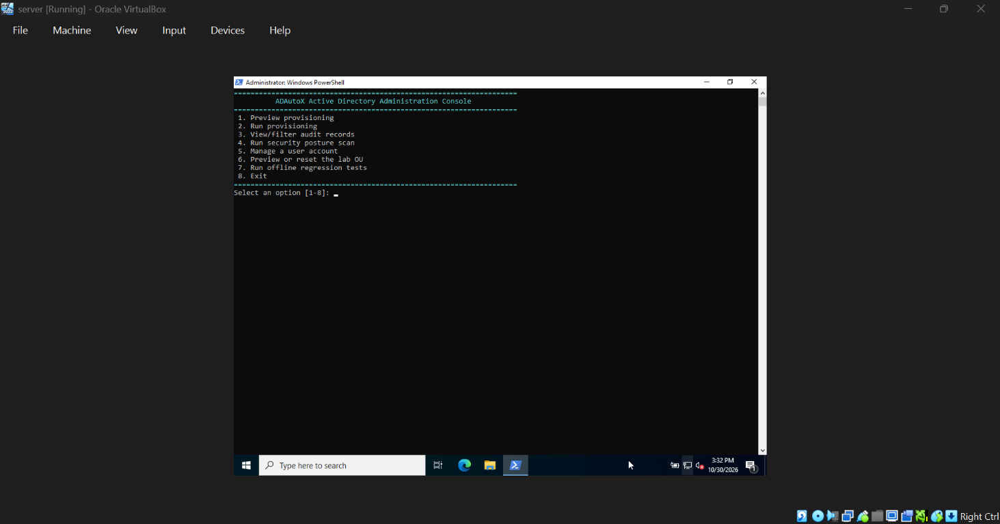

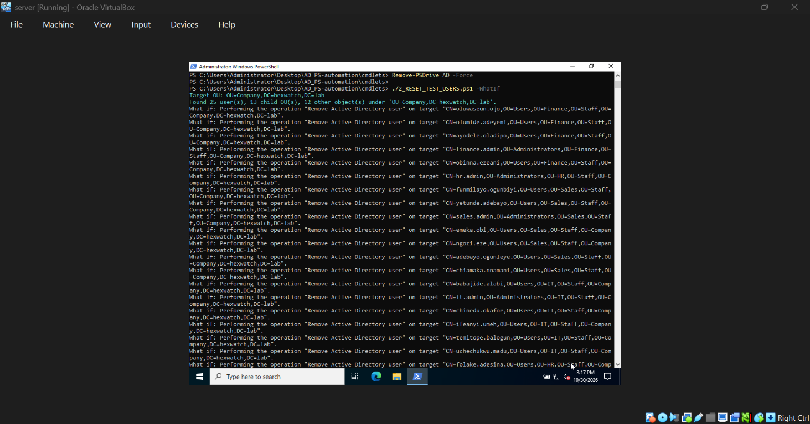

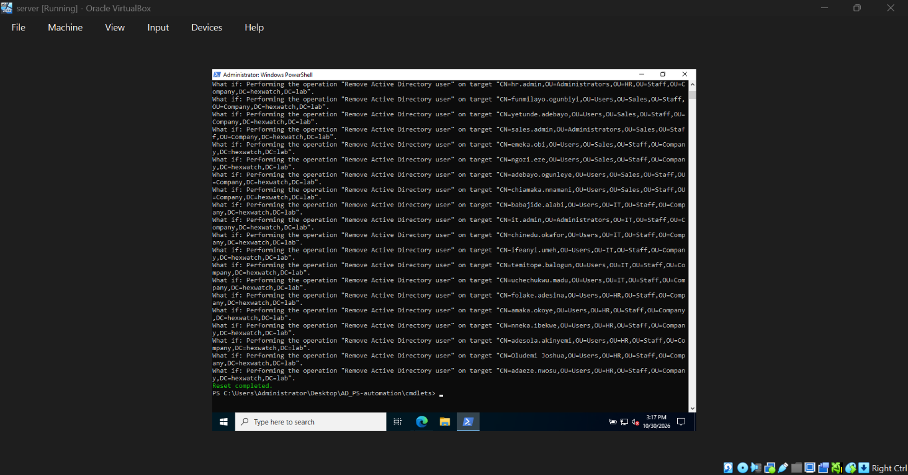

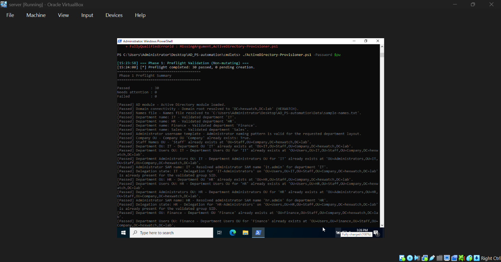

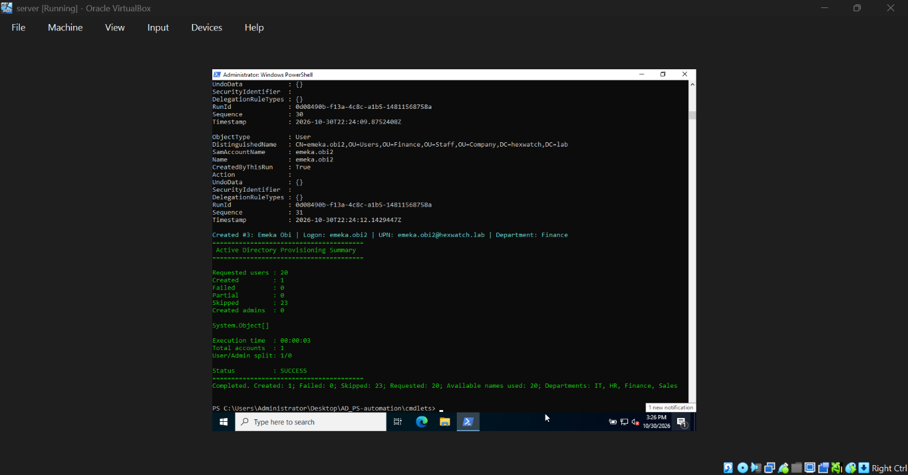

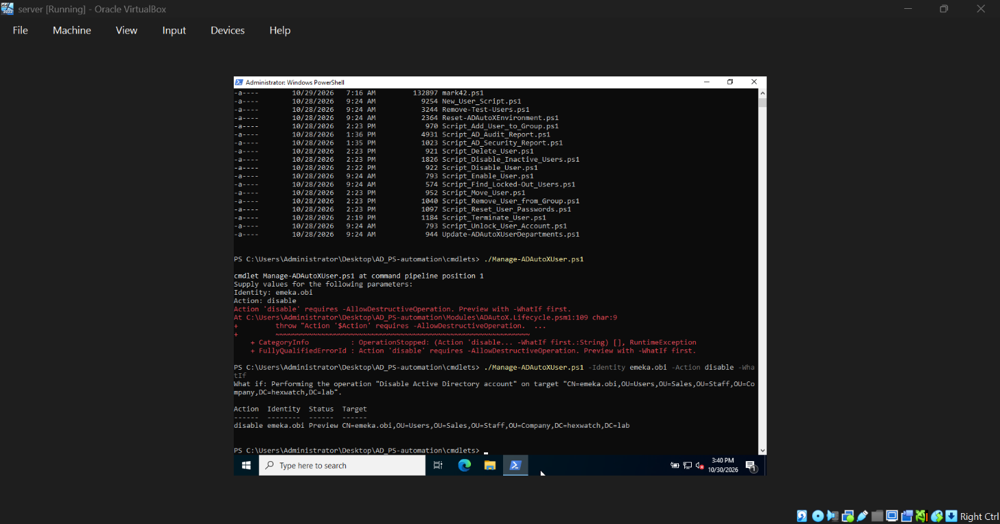

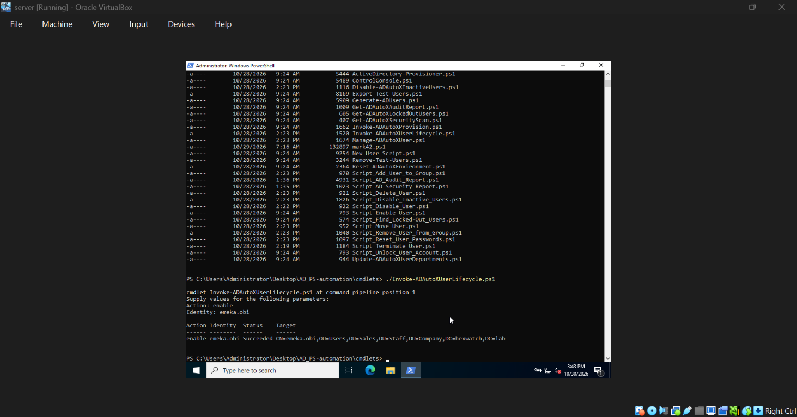

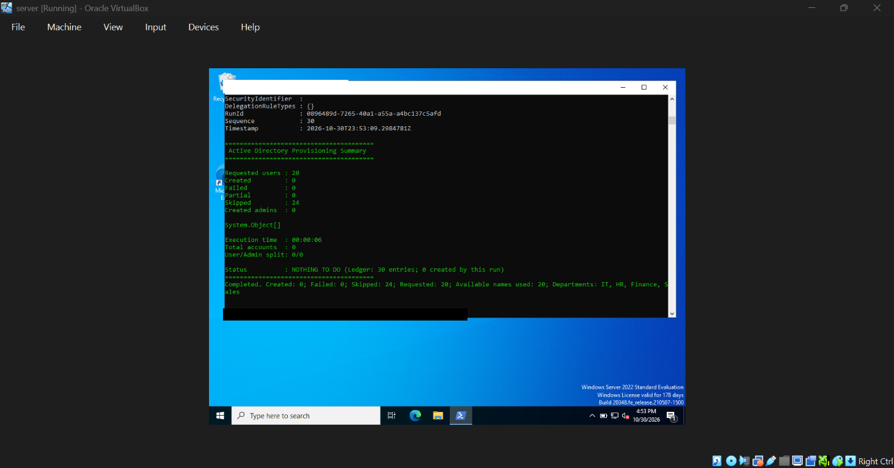

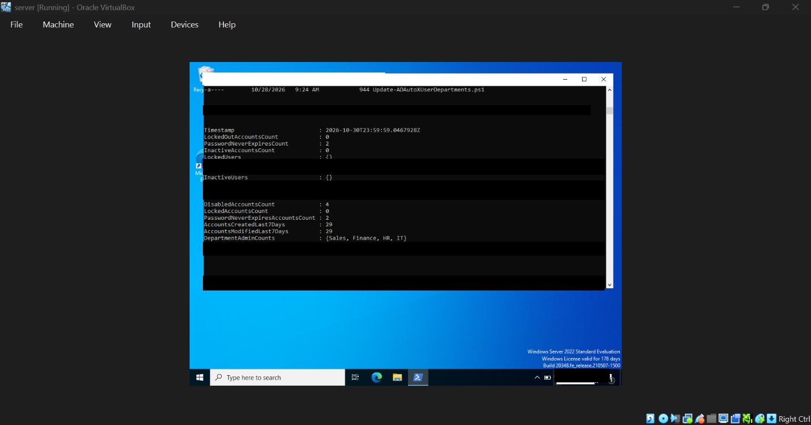

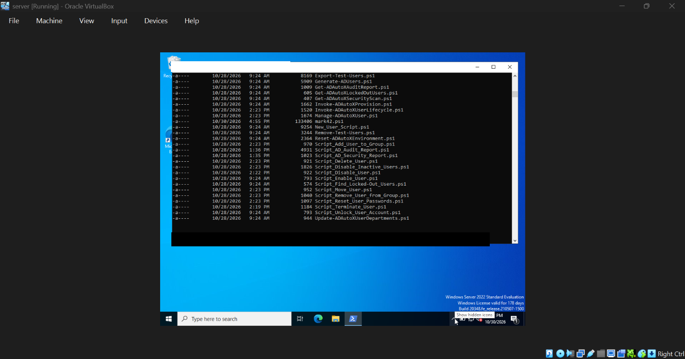

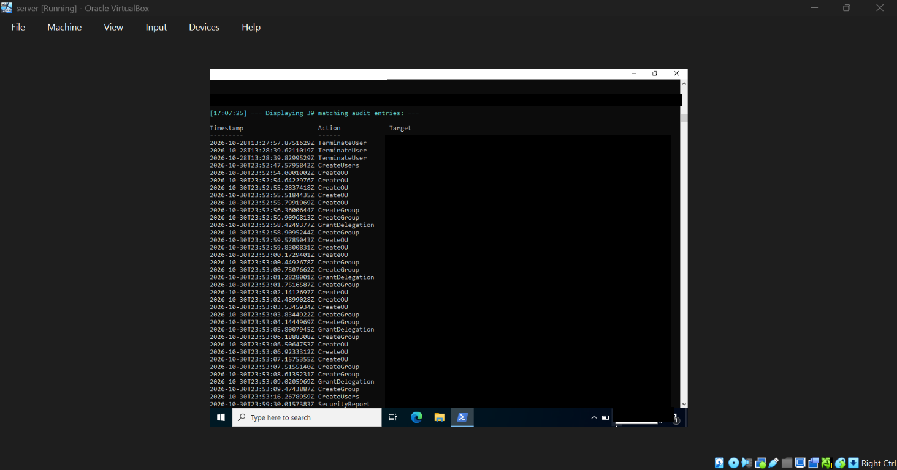

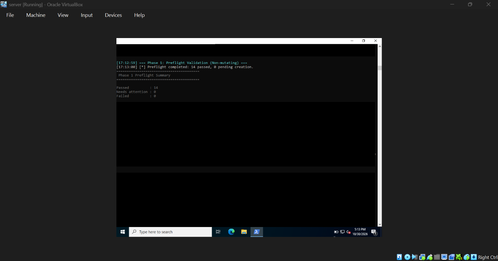

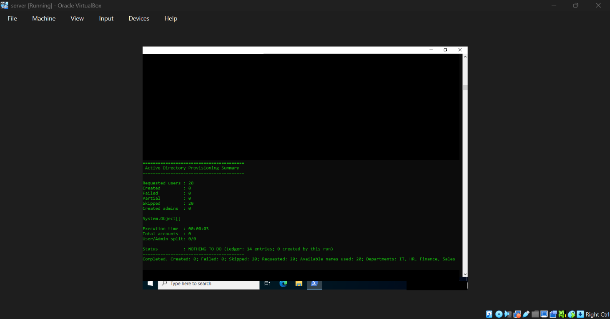

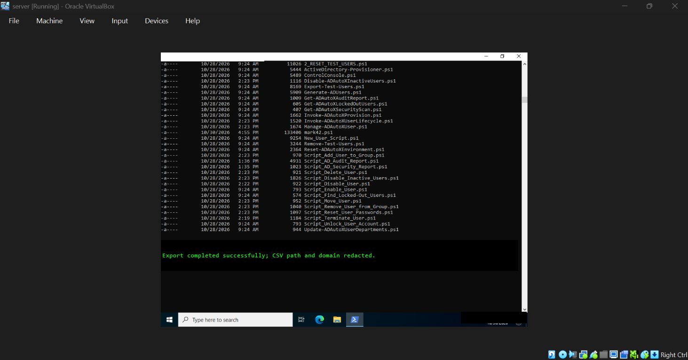

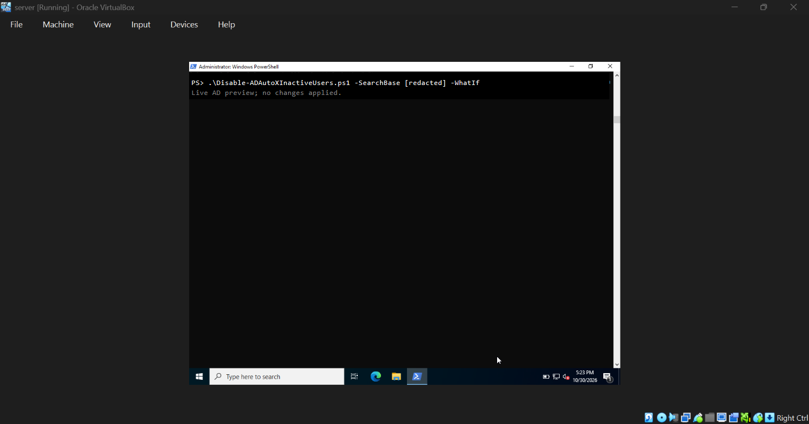


</details>

## Repository layout

```text
AD_PS-automation/
├── Cmdlets/       User-facing command scripts and compatibility wrappers
├── Modules/       ADAutoX manifest, shared operations, provisioning, and lifecycle modules
├── Tests/         Offline, parser, diagnostic, and opt-in AD integration tests
├── Data/          Sample provisioning names
├── docs/          Project and manual-test screenshots
├── .gitignore     Ignores credentials, audit logs, reports, and local output
├── README.md      Project overview, setup, safety, and command index
├── PROJECT_GUIDE.md
│                  Detailed operational and technical reference
```

`AD-Operations.jsonl` may be generated locally by a run and is ignored by `.gitignore`.

## Detailed technical guide

[`PROJECT_GUIDE.md`](./PROJECT_GUIDE.md) documents the module architecture, provisioning workflow and parameters, lifecycle safeguards, delegation model, rollback behavior, audit schema, testing instructions, troubleshooting, limitations, and detailed script/module references.

## Disclaimer

Outside preview mode, these scripts can make real directory changes, including creating accounts, changing passwords or group membership, disabling or deleting accounts, and removing directory resources. Use them only with explicit authorization. Review the target domain and distinguished name, preview first, test with a small scope, inspect reports and audit records, and follow formal change control for production environments.
