# AD_PS-automation


**AD_PS-automation** is a PowerShell toolkit for repeatable Active Directory provisioning, user lifecycle operations, security and audit reporting, and controlled lab cleanup.

A shared `ADAutoX` module provides the public API and the common context, validation, safety, verification, logging, and rollback services used by every command script.

> **Intended scope.** Designed for lab, test, and carefully controlled administrative use. Production use requires your organization's security review, authorization, and change-control process.

## Contents

- [Capabilities](#capabilities)
- [Requirements and setup](#requirements-and-setup)
- [Quick start](#quick-start)
- [Provisioning model](#provisioning-model)
- [User lifecycle and reporting](#user-lifecycle-and-reporting)
- [Safety, audit, and rollback](#safety-audit-and-rollback)
- [Modules at a glance](#modules-at-a-glance)
- [Command reference](#command-reference)
- [Testing and verification](#testing-and-verification)
- [Repository layout](#repository-layout)
- [Documentation](#documentation)
- [Disclaimer](#disclaimer)

---

## Capabilities

| Area | What it covers |
| --- | --- |
| **Provisioning** | Department-based OUs, security groups, standard users, department administrator accounts, and scoped delegation |
| **User lifecycle** | Enable, disable, unlock, reset password, move, terminate, delete, and change group membership |
| **Reporting** | Locked-account discovery, account posture scans, department attribute updates, user export, provisioning reports, JSONL audit logs, and filtered audit and security reports |
| **Safety** | Native `-WhatIf` / `-Confirm` previews and explicit approval switches for high-impact operations |
| **Assurance** | Post-change verification where implemented, and rollback of eligible run-created or lifecycle changes |

## Requirements and setup

**Requirements**

- Windows PowerShell 5.1, or PowerShell 7 on Windows
- The Active Directory PowerShell module (RSAT) available to the session
- Network access to an appropriate domain controller, and an account with the rights needed for the operation
- For provisioning: a dedicated test OU or disposable test domain, until the exact plan and permissions have been reviewed

**Verify the environment** from the repository root:

```powershell
Import-Module ActiveDirectory
Get-ADDomain
```

**Load the module.** `Modules\ADAutoX.psd1` is the supported entry point:

```powershell
Import-Module .\Modules\ADAutoX.psd1
Get-Command -Module ADAutoX
```

Command scripts import the project modules relative to their own location. Run them from the repository root using `.\Cmdlets\...` paths. Relative paths supplied as parameters resolve from the current PowerShell location unless a command documents otherwise.

## Quick start

**1. Validate the repository** (no AD connection):

```powershell
.\Tests\validate_repo.ps1
.\Tests\Run-OfflineTests.ps1
```

**2. Preview provisioning:**

```powershell
.\Cmdlets\mark42.ps1 -AccountCount 5 -WhatIf
```

**3. Preview a lifecycle action.** Disable, terminate, delete, and group-removal actions require their destructive-operation switch even for a preview:

```powershell
.\Cmdlets\Script_Disable_User.ps1 -Identity 'jdoe' -AllowDestructiveOperation -WhatIf
.\Cmdlets\Script_Move_User.ps1 -Identity 'jdoe' `
    -TargetPath 'OU=Users,OU=IT,OU=Staff,OU=Company,DC=example,DC=com' -WhatIf
```

**4. Review before approving.** Check the command output, target distinguished name, audit record, and any generated report, then rerun without `-WhatIf` to apply.

> **`-WhatIf` is not an offline simulation.** Read-only Active Directory queries and preflight checks can still run.

---

## Provisioning model

[`mark42.ps1`](./Cmdlets/mark42.ps1) is the canonical bulk provisioner.

**Defaults:** 20 standard users; departments IT, HR, Finance, and Sales; department administrator accounts enabled. It builds this layout beneath the domain:

```text
Company
└── Staff
    ├── IT
    │   ├── Users
    │   └── Administrators
    ├── HR
    │   ├── Users
    │   └── Administrators
    ├── Finance
    │   ├── Users
    │   └── Administrators
    └── Sales
        ├── Users
        └── Administrators
```

Names are read from [`Data/sample-names.txt`](./Data/sample-names.txt) by default. Standard users are distributed across departments, and generated account names are checked for collisions. Existing compatible resources are reused, not recreated.

### Workflow

| Stage | What happens |
| --- | --- |
| **1. Preflight** | Resolves a writable DC; checks dependencies, inputs, domain, naming conflicts, OUs, groups, permissions, and applicable delegation |
| **2. Provision** | Creates the requested OUs, groups, users, memberships, and scoped delegation |
| **3. Verify** | Re-queries created accounts and verifies attributes, locations, enablement, and memberships where supported |
| **4. Report** | Emits a console summary, a CSV report, and structured audit records |

### Common options

| Option | Purpose |
| --- | --- |
| `-Departments`, `-OrganizationalUnitName` | Change the department list and top-level OU |
| `-NamesPath` | Use a custom names file |
| `-AdministratorsOnly` | Provision only administrator OUs, groups, and accounts |
| `-CreateDepartmentAdministrators:$false` | Skip administrator accounts |
| `-EnableAccountsAfterVerification` | Create accounts disabled, verify, then enable and verify again |
| `-Server`, `-Credential` | Choose the DC and the credentials used |
| `-ReportPath`, `-AuditLogPath` | Choose report and audit output locations |

Passwords are generated per account by default. See the [technical guide](./PROJECT_GUIDE.md) for password patterns, credential export controls, rollback options, and the full parameter reference.

---

## User lifecycle and reporting

Use a named script for a single task, or [`Manage-ADAutoXUser.ps1`](./Cmdlets/Manage-ADAutoXUser.ps1) as one entry point for the common lifecycle actions. The general dispatcher, [`Invoke-ADAutoXUserLifecycle.ps1`](./Cmdlets/Invoke-ADAutoXUserLifecycle.ps1), additionally exposes the delete and group-add actions.

| Task | Script |
| --- | --- |
| Create and verify one account | `New_User_Script.ps1` |
| Enable / disable / unlock | `Script_Enable_User.ps1`, `Script_Disable_User.ps1`, `Script_Unlock_User_Account.ps1` |
| Reset password / move / terminate / delete | `Script_Reset_User_Passwords.ps1`, `Script_Move_User.ps1`, `Script_Terminate_User.ps1`, `Script_Delete_User.ps1` |
| Add or remove group membership | `Script_Add_User_to_Group.ps1`, `Script_Remove_User_from_Group.ps1` |
| Find locked accounts | `Script_Find_Locked-Out_Users.ps1` |
| Disable inactive accounts | `Script_Disable_Inactive_Users.ps1`, `Disable-ADAutoXInactiveUsers.ps1` |
| Security posture report | `Script_AD_Security_Report.ps1`, `Get-ADAutoXSecurityScan.ps1` |
| Audit report | `Script_AD_Audit_Report.ps1`, `Get-ADAutoXAuditReport.ps1` |
| Update department attributes | `Update-ADAutoXUserDepartments.ps1` |
| Export users to CSV | `Export-Test-Users.ps1` |

**Report behavior**

- Locked-account discovery uses `Search-ADAccount -LockedOut -UsersOnly`, then retrieves the user properties each report needs.
- Security reporting accepts an optional `-SearchBase`. When omitted, it uses the configured company OU if found, otherwise the domain scope. Review the report command's help before running a broad search.

---

## Safety, audit, and rollback

| Control | Behavior |
| --- | --- |
| **Preview and confirmation** | Only commands declaring `SupportsShouldProcess` accept `-WhatIf` and `-Confirm`. Check `Get-Help <command> -Full`; common parameters are not guaranteed on every script. |
| **Destructive-operation gates** | Applicable actions require explicit switches such as `-AllowDestructiveOperation`. Cleanup also checks the exact target DN. `-Force` does not replace these safeguards. |
| **Protected-account checks** | Lifecycle operations guard privileged, critical, built-in, and current-operator accounts. `-AllowProtectedAccount` is an explicit, audited bypass where supported. |
| **Pinned domain controller** | Each operation resolves or accepts a DC and uses one consistent AD context. An unowned pre-existing `AD:` drive that cannot be verified is rejected; start a clean session or remove the conflicting drive. |
| **Audit trail** | Instrumented operations append JSONL records to `AD-Operations.jsonl` by default (override with `-AuditLogPath`). Coverage is action-specific, not a record of every read. |
| **Rollback** | The in-memory session ledger can reverse eligible lifecycle operations and remove eligible resources created during a run. It does not survive a PowerShell restart and cannot restore password resets, unlocks, or deletions. Rollback is best-effort: inspect AD and the audit log afterward. |
| **Credential handling** | Credential export is opt-in and protected with Windows DPAPI. `-IncludePasswordInReport` writes **plaintext** passwords to CSV; avoid it unless specifically approved and securely handled. |
| **Scoped delegation** | Department administrators receive narrowly scoped permissions. Sensitive attribute rights are not granted by default. |

> **Handle output with care.** Reports and logs can contain account names, distinguished names, operator details, and machine information. Apply access controls, keep sensitive output out of source control, and follow your retention policy.

---

## Modules at a glance

Import [`ADAutoX.psd1`](./Modules/ADAutoX.psd1). Its public API is divided across these implementation files:

| Module file | Responsibility |
| --- | --- |
| [`ADAutoX.psd1`](./Modules/ADAutoX.psd1) | Manifest, minimum PowerShell version, exported functions, and aliases |
| [`ADAutoX.psm1`](./Modules/ADAutoX.psm1) | Module loader and facade for provisioning, security scans, shared context, preflight, and rollback |
| [`ADAutoX.Lifecycle.psm1`](./Modules/ADAutoX.Lifecycle.psm1) | Guarded lifecycle actions, inactivity and locked-account workflows, department updates, audit, and lifecycle ledger operations |
| [`AD-Operations.psm1`](./Modules/AD-Operations.psm1) | AD context, identity and OU resolution, LDAP/DN helpers, preflight support, safe file and CSV operations, and audit writing |
| [`AD-Provisioning.psm1`](./Modules/AD-Provisioning.psm1) | Provisioning validation, password and account-name generation, OU/group/user creation, verification, delegation, reports, and rollback helpers |

For exported function names and detailed behavior, run `Get-Command -Module ADAutoX` and see the [module reference](./PROJECT_GUIDE.md#reference).

---

## Command reference

Every script in `Cmdlets\` is indexed below. Run commands from the repository root, and review each script's help and the [technical reference](./PROJECT_GUIDE.md#reference) for full parameters, defaults, and safeguards.

> **Wrappers.** Compatibility wrappers can preserve older names, parameter shapes, or defaults. Prefer the canonical command or module API for new automation, and inspect a wrapper's help rather than assuming it matches the canonical entry point.

### Provisioning and account creation

| Script | Purpose and notes |
| --- | --- |
| [`mark42.ps1`](./Cmdlets/mark42.ps1) | Canonical bulk provisioner: department OUs, groups, users, administrator accounts, scoped delegation, verification, reports, and eligible rollback |
| [`Invoke-ADAutoXProvision.ps1`](./Cmdlets/Invoke-ADAutoXProvision.ps1) | Module-backed provisioning entry point with company/staff OU options and run rollback |
| [`ActiveDirectory-Provisioner.ps1`](./Cmdlets/ActiveDirectory-Provisioner.ps1) | *Legacy wrapper.* Retains older interface conventions |
| [`Generate-ADUsers.ps1`](./Cmdlets/Generate-ADUsers.ps1) | *Legacy wrapper.* Retains legacy defaults, including the meaning of `-AccountCount 0` |
| [`New_User_Script.ps1`](./Cmdlets/New_User_Script.ps1) | Create and verify one user account |

### User lifecycle

| Script | Purpose and notes |
| --- | --- |
| [`Manage-ADAutoXUser.ps1`](./Cmdlets/Manage-ADAutoXUser.ps1) | Convenience dispatcher for common user actions |
| [`Invoke-ADAutoXUserLifecycle.ps1`](./Cmdlets/Invoke-ADAutoXUserLifecycle.ps1) | General dispatcher, including delete and group-add actions |
| [`Script_Enable_User.ps1`](./Cmdlets/Script_Enable_User.ps1) | Enable one user account |
| [`Script_Disable_User.ps1`](./Cmdlets/Script_Disable_User.ps1) | Disable one user account; requires the destructive-operation gate |
| [`Script_Unlock_User_Account.ps1`](./Cmdlets/Script_Unlock_User_Account.ps1) | Unlock one user account |
| [`Script_Reset_User_Passwords.ps1`](./Cmdlets/Script_Reset_User_Passwords.ps1) | Reset one user's password, with secure input and optional change-at-logon |
| [`Script_Move_User.ps1`](./Cmdlets/Script_Move_User.ps1) | Move one user to a specified OU |
| [`Script_Terminate_User.ps1`](./Cmdlets/Script_Terminate_User.ps1) | Disable a user, optionally move the account, and record a termination reason |
| [`Script_Delete_User.ps1`](./Cmdlets/Script_Delete_User.ps1) | Delete one user; requires the destructive-operation gate |
| [`Script_Add_User_to_Group.ps1`](./Cmdlets/Script_Add_User_to_Group.ps1) | Add a user to a group |
| [`Script_Remove_User_from_Group.ps1`](./Cmdlets/Script_Remove_User_from_Group.ps1) | Remove a user from a group; requires destructive-operation approval |

### Account health and reporting

| Script | Purpose and notes |
| --- | --- |
| [`Script_Disable_Inactive_Users.ps1`](./Cmdlets/Script_Disable_Inactive_Users.ps1) | Disable one identified user, or run the inactivity workflow |
| [`Disable-ADAutoXInactiveUsers.ps1`](./Cmdlets/Disable-ADAutoXInactiveUsers.ps1) | Module-backed bulk inactivity workflow with scoping and approval safeguards |
| [`Script_Find_Locked-Out_Users.ps1`](./Cmdlets/Script_Find_Locked-Out_Users.ps1) | Find and optionally export locked-out users |
| [`Get-ADAutoXLockedOutUsers.ps1`](./Cmdlets/Get-ADAutoXLockedOutUsers.ps1) | Module-backed locked-account query |
| [`Get-ADAutoXSecurityScan.ps1`](./Cmdlets/Get-ADAutoXSecurityScan.ps1) | Structured scan for locked-out, inactive, and password-never-expires accounts |
| [`Script_AD_Security_Report.ps1`](./Cmdlets/Script_AD_Security_Report.ps1) | Human-readable security report; set a deliberate search scope |
| [`Update-ADAutoXUserDepartments.ps1`](./Cmdlets/Update-ADAutoXUserDepartments.ps1) | Update department attributes from the configured OU layout |
| [`Script_AD_Audit_Report.ps1`](./Cmdlets/Script_AD_Audit_Report.ps1) | Read and filter JSONL audit records; no AD connection required |
| [`Get-ADAutoXAuditReport.ps1`](./Cmdlets/Get-ADAutoXAuditReport.ps1) | Module-backed audit filtering and report export |
| [`Export-Test-Users.ps1`](./Cmdlets/Export-Test-Users.ps1) | Export users under an OU to CSV |

### Cleanup and operations

| Script | Purpose and notes |
| --- | --- |
| [`Remove-Test-Users.ps1`](./Cmdlets/Remove-Test-Users.ps1) | Friendly, guarded wrapper for scoped test-resource cleanup |
| [`2_RESET_TEST_USERS.ps1`](./Cmdlets/2_RESET_TEST_USERS.ps1) | Performs scoped test-resource cleanup; destructive options require explicit safeguards |
| [`Reset-ADAutoXEnvironment.ps1`](./Cmdlets/Reset-ADAutoXEnvironment.ps1) | Rolls back the current session ledger, or invokes guarded test cleanup |
| [`ControlConsole.ps1`](./Cmdlets/ControlConsole.ps1) | Interactive menu for provisioning, reports, account management, cleanup preview, and offline tests |

---

## Testing and verification

### Test and diagnostic scripts

| Script | Purpose | AD impact |
| --- | --- | --- |
| [`validate_repo.ps1`](./Tests/validate_repo.ps1) | Parses PowerShell source and fails on syntax errors | No AD connection |
| [`Run-OfflineTests.ps1`](./Tests/Run-OfflineTests.ps1) | Checks helper behavior, exports, wrapper wiring, audit and rollback contracts, and safety regressions | No AD connection |
| [`Run-ADIntegrationTests.ps1`](./Tests/Run-ADIntegrationTests.ps1) | Opt-in integration test. Requires `-RunLive`, the expected DNS root, and a disposable test domain; creates and rolls back uniquely named resources | **Makes live changes** in the explicitly selected test domain |
| [`Diagnose-ADAcl.ps1`](./Tests/Diagnose-ADAcl.ps1) | Diagnoses AD provider, DC, OU lookup, and ACL-read behavior. Accepts optional `-Server`, `-DistinguishedName`, `-Credential` | AD reads only; for troubleshooting |

> **The formal integration suite has not yet been verified in a live domain.**

### Manual test evidence

| Script | Result | Evidence |
| --- | --- | --- |
| `mark42.ps1` | Exercised successfully in a lab | Lab run |
| `Script_Terminate_User.ps1` | Exercised successfully in a lab | `-WhatIf` preview, then an approved run |
| `Script_Reset_User_Passwords.ps1` | Completed against a real AD domain | Successful run |
| `Script_Move_User.ps1` | Completed against a real AD domain | Successful run |
| `Script_Enable_User.ps1` | Completed against a real AD domain | Successful run |
| `Script_Add_User_to_Group.ps1` | Added a user to a group in real AD | Resulting membership and audit record |
| `New_User_Script.ps1` | Tested against real AD | Existing-account rejection, then successful creation of a different user |
| `Script_AD_Security_Report.ps1` | Completed against a real AD domain | Report output |
| `Script_AD_Audit_Report.ps1` | Produced a summary from the JSONL audit log | Summary output |
| `Reset-ADAutoXEnvironment.ps1` | Completed its reset workflow | `-WhatIf` preview and completion message |
| `Remove-Test-Users.ps1` | Exercised against real AD | `-WhatIf` preview and cleanup completion output |
| `Script_Disable_User.ps1` | Exercised against real AD; **live completion not shown** | Destructive-operation guard and `-WhatIf` preview |
| `Script_Delete_User.ps1` | Exercised against real AD; **live completion not shown** | Destructive-operation guard and `-WhatIf` preview |
| Other scripts | Testing in progress | None yet |

Manual tests do not imply that every parameter combination, AD topology, policy, or permission set has been tested.

> **Handle screenshots with care.** They may contain account names, directory identifiers, or local filesystem paths. The security report screenshot shows the domain and privileged account names, and the audit report screenshot shows a local account name and filesystem path. The reset and test-user cleanup workflows are destructive: review their scope and use `-WhatIf` before approving a run.

<details>
<summary><strong>View test screenshots</strong></summary>

&nbsp;

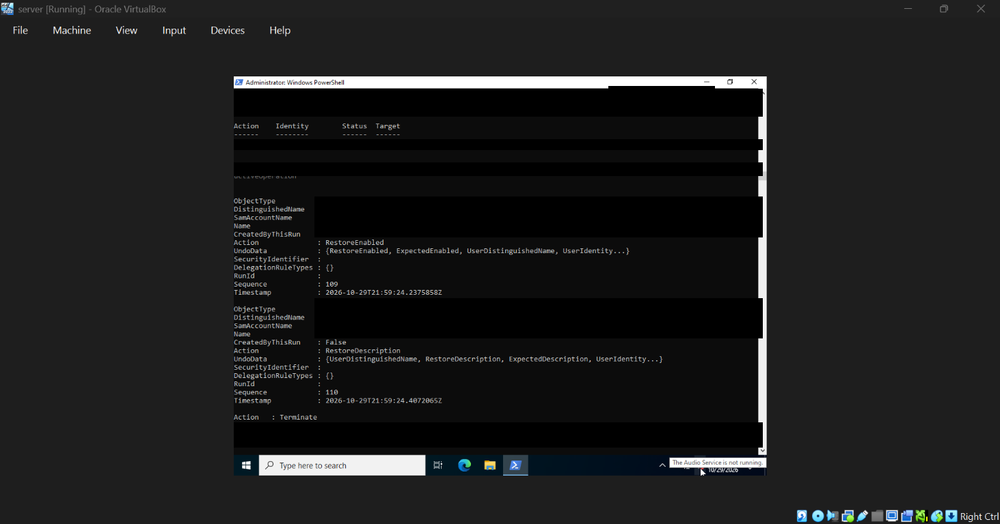

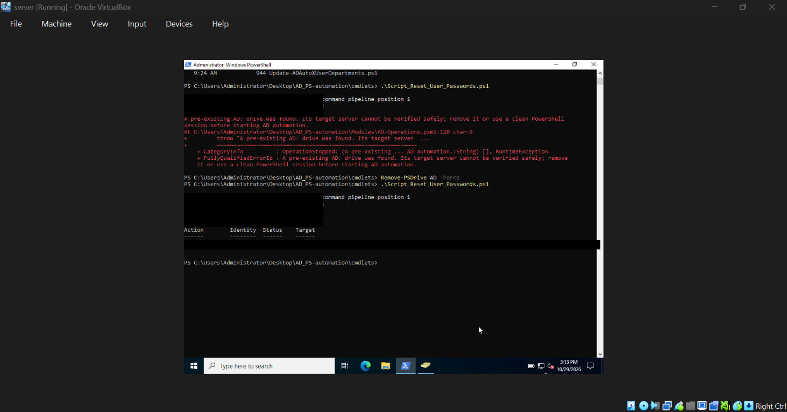

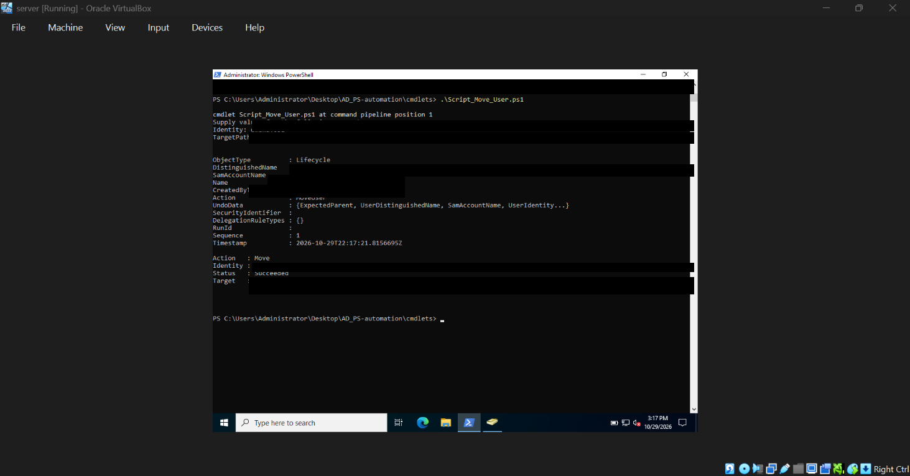

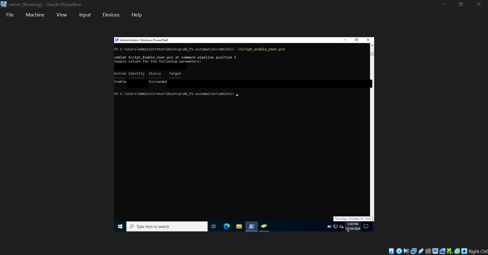

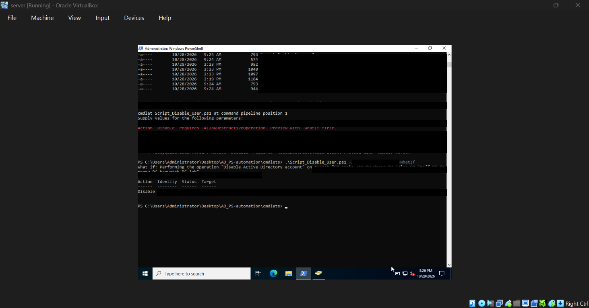

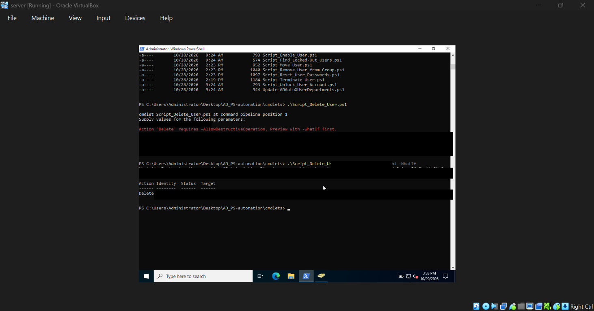

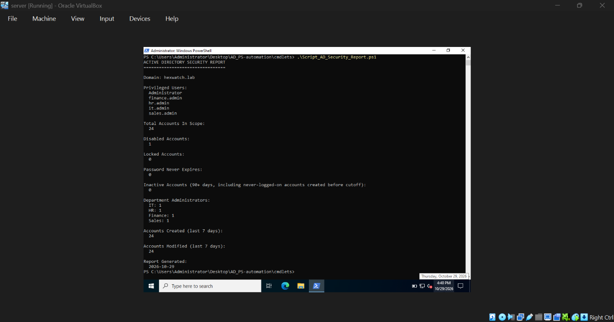

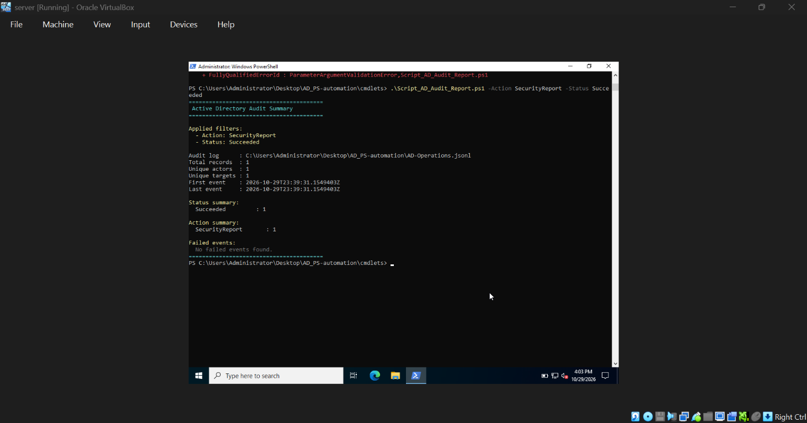

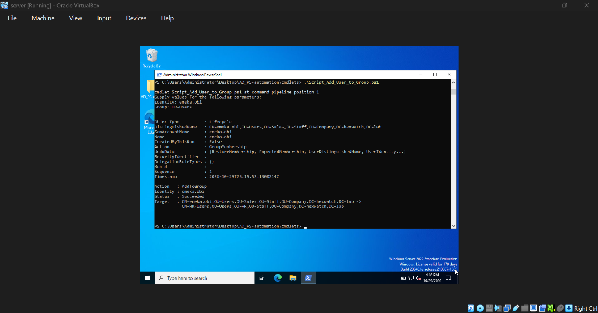

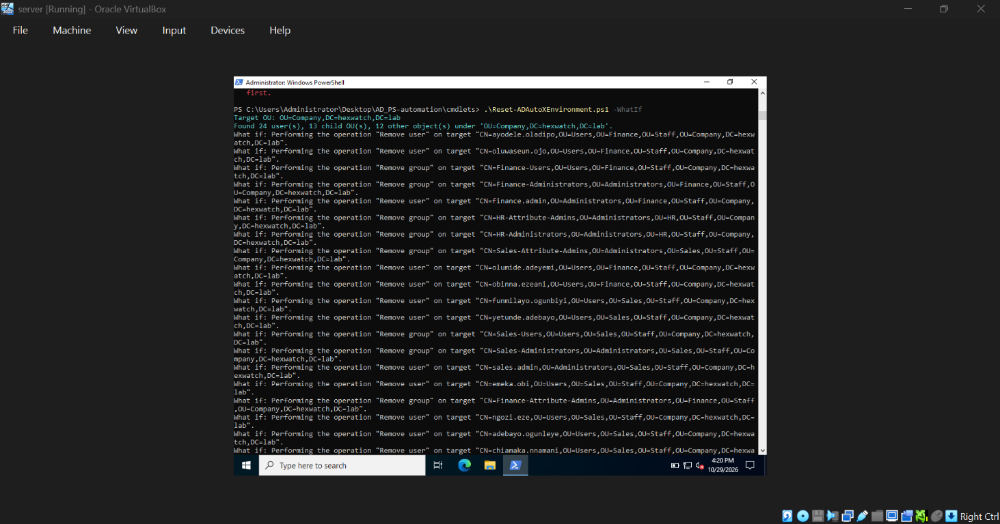

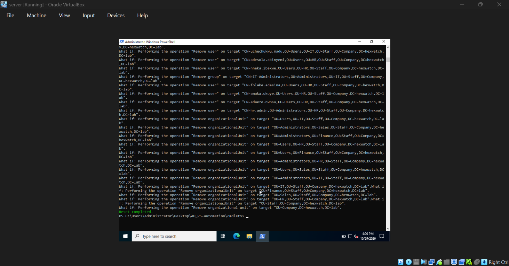

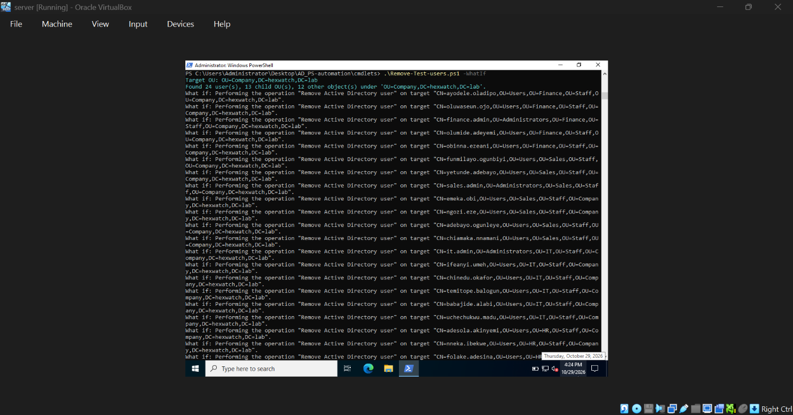

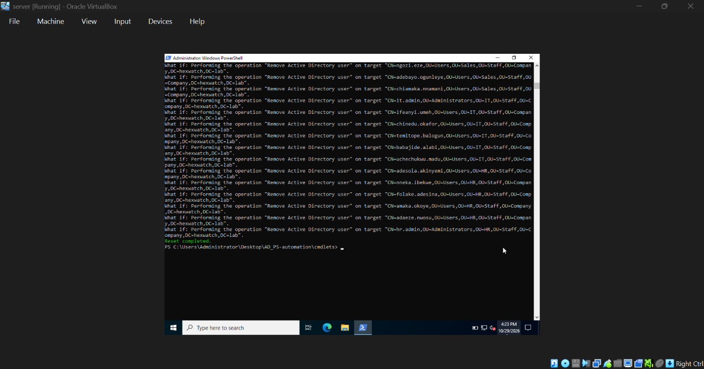

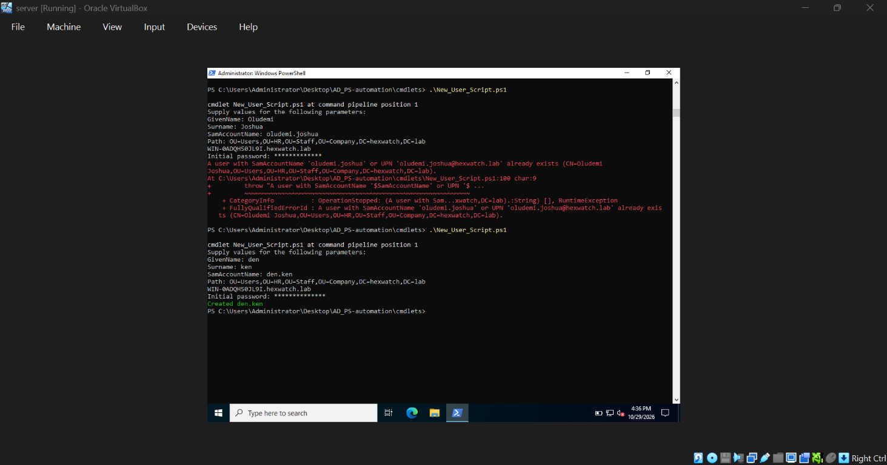

</details>

---

## Repository layout

```text
AD_PS-automation/
├── Cmdlets/           User-facing command scripts and compatibility wrappers
├── Modules/           ADAutoX manifest, shared operations, provisioning, and lifecycle modules
├── Tests/             Offline, parser, diagnostic, and opt-in AD integration tests
├── Data/              Sample provisioning names
├── docs/              Project and manual-test screenshots
├── README.md          Project overview, setup, safety, and command index
├── PROJECT_GUIDE.md   Detailed operational and technical reference
└── AD-Operations.jsonl  Default structured audit log (generated or updated by runs)
```

## Documentation

[`PROJECT_GUIDE.md`](./PROJECT_GUIDE.md) is the detailed technical reference. It covers the module architecture, provisioning workflow and parameters, lifecycle safeguards, delegation model, rollback behavior, audit schema, testing instructions, troubleshooting, limitations, and per-script and per-module references.

## Disclaimer

Outside preview mode, these scripts make **real directory changes**, including creating accounts, changing passwords or group membership, disabling or deleting accounts, and removing lab resources. Use them only with explicit authorization. Review the target domain and distinguished name, preview first, test with a small scope, inspect reports and audit records, and follow formal change control for production environments.
