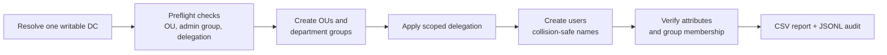

# AD_PS


**PowerShell automation for Active Directory provisioning, user lifecycle administration, and audit reporting, built for lab and test environments with production-style safety habits.**

AD_PS creates a department-based OU structure with scoped delegation, bulk-provisions test users, runs lifecycle operations (enable, disable, move, terminate, delete), and records instrumented actions as structured JSONL. Mutating commands use native `-WhatIf` / `-Confirm` where their interfaces support `ShouldProcess`; verification behavior is command-specific.

> **Scope:** Intended for lab, test, and controlled administrative use. Anything beyond a lab should go through your organization's change control and security review.

## Contents

- [Highlights](#highlights)
- [Quick start](#quick-start)
- [How a provisioning run works](#how-a-provisioning-run-works)
- [Default OU layout](#default-ou-layout)
- [Delegation model](#delegation-model)
- [Common usage](#common-usage)
  - [Canonical provisioning command](#canonical-provisioning-command-mark42ps1)
- [Script reference](#script-reference)
  - [Provisioning and users](#provisioning-and-users)
  - [Export and cleanup](#export-and-cleanup)
  - [User lifecycle and group membership](#user-lifecycle-and-group-membership)
  - [Account-health commands](#account-health-commands)
  - [Audit reports](#audit-reports)
  - [Modules and public API](#modules-and-public-api)
  - [Tests, data, and compatibility launcher](#tests-data-and-compatibility-launcher)
- [Audit logging](#audit-logging)
- [Security model](#security-model)
- [Testing](#testing)
- [Limitations](#limitations)
- [Cleanup](#cleanup)
- [Troubleshooting](#troubleshooting)
- [Disclaimer](#disclaimer)

## Highlights

| Principle | What it means in practice |
| --- | --- |
| **Auditable** | Provisioning and lifecycle commands write structured JSONL records for the operations they instrument, including failures and verification outcomes. |
| **Verified** | Lifecycle scripts re-query AD after a change (group membership, enabled state, password state) rather than trusting a cmdlet that returned without error. |
| **Previewable** | Provisioning and lifecycle mutations use PowerShell's native `ShouldProcess` support where exposed. There is no custom dry-run flag. |
| **Gated** | Destructive operations need an explicit switch such as `-AllowDestructiveOperation` on top of PowerShell's own confirmation. |
| **Rerun-safe** | Existing matching identities are detected before creation, so repeating a run does not produce duplicate or colliding accounts. |
| **Least privilege** | Department administrators receive narrowly scoped user create/delete and read rights. Sensitive attribute writes are reserved for separately reviewed delegation. |

## Quick start

**Requirements**

- Windows PowerShell 5.1 or PowerShell 7+
- The `ActiveDirectory` module (install RSAT if `Import-Module ActiveDirectory` fails)
- Network access to a writable domain controller
- An account with the delegated rights you intend to use
- A dedicated test OU and an approved change window

**Run it**

```powershell
# 1. Open PowerShell in the cloned AD_PS-automation repository root and confirm AD connectivity
Import-Module ActiveDirectory
Get-ADDomain

# 2. Preview (no changes; may still run read-only AD queries)
.\Cmdlets\mark42.ps1 -AccountCount 5 -WhatIf

# 3. Create test users
.\Cmdlets\mark42.ps1 -AccountCount 5

# 4. Snapshot what was created
.\Cmdlets\Export-Test-Users.ps1 -OrganizationalUnitName 'Company'

# 5. Review the audit trail
.\Cmdlets\Script_AD_Audit_Report.ps1

# 6. Clean up (preview first)
.\Cmdlets\Remove-Test-Users.ps1 -OrganizationalUnitName 'Company' -WhatIf
.\Cmdlets\Remove-Test-Users.ps1 -OrganizationalUnitName 'Company' -AllowDestructiveOperation `
    -ExpectedDistinguishedName 'OU=Company,DC=example,DC=com'
```

In multi-DC environments, pass `-Server <dc>` to choose the writable DC. If you omit it, one writable DC is resolved at startup and reused for the whole run, including verification and delegation ACL changes.

## How a provisioning run works



- Account names are checked against existing AD accounts and names generated in the same run before any suffixing.
- Users are enabled and their required department attributes validated immediately after creation.
- For a stricter enablement sequence, use `-EnableAccountsAfterVerification` to create users and administrators disabled, verify their attributes and group membership, then enable and re-verify each account.
- Failures capture structured error metadata, and the report includes execution context (domain, forest, DC, operator, timestamp, PowerShell version, OS).
- With `-RollbackCreatedAccountsOnFailure`, only accounts created by the current run are removed. See [Limitations](#limitations).
- The ADAutoX compatibility command's `-RollbackOnFailure` also cleans up run-created groups, its exact delegation ACEs, and only empty provisioner-marked OUs; it never recursively deletes an OU.

`Cmdlets\mark42.ps1` is the canonical provisioning implementation. `Cmdlets\ActiveDirectory-Provisioner.ps1`
and `Cmdlets\Generate-ADUsers.ps1` retain their command-line interfaces as compatibility wrappers,
so fixes to provisioning behavior are maintained in one implementation.

Command implementations are organized under `Cmdlets\`, reusable modules and the supported
manifest are under `Modules\`, name data is in `Data\`, and offline checks are under `Tests\`.
Run command scripts from the repository root using their `.\Cmdlets\...` paths.

## Default OU layout

```text
Company
  Staff
    IT / HR / Finance / Sales        (default departments)
      Users
      Administrators
```

Employees are created in each department's `Users` OU. Department administrator accounts (and their groups) are created in `Administrators` by default; pass `-CreateDepartmentAdministrators:$false` to skip them. Use `-Departments` and `-OrganizationalUnitName` to change the layout.

## Delegation model

| Role | Can | Cannot |
| --- | --- | --- |
| `Department-Administrators` | Create and delete users in their department `Users` OU; list and read user objects there | Broad property writes |
| `Department-Attribute-Admins` | Reserved for explicitly reviewed attribute rights | Password reset, enable/disable, unlock, or anything else not individually granted |
| Audit and report consumers | Read the JSONL log and reports | Should have read-only access |

Safeguards around delegation:

- Administrator groups are validated by expected name, location, security category, Global scope, and SID.
- New delegation is granted only to a group **created during the current run**. A pre-existing group is accepted only if a SID-matched delegation ACE is already present.
- Create/delete-child rights apply directly to the department `Users` OU; list/read rights are separately scoped to descendant User objects.

## Common usage

```powershell
# Custom departments
.\Cmdlets\mark42.ps1 -AccountCount 20 -Departments 'Engineering','Support','Operations'

# Custom names file and OU name
.\Cmdlets\mark42.ps1 -NamesPath '.\custom-names.txt' -OrganizationalUnitName '_LAB-USERS'

# Deterministic password pattern
.\Cmdlets\mark42.ps1 -AccountCount 10 -PasswordPattern 'Training-{0}-Strong!'

# Prompt securely for one shared password (use a unique password for a real deployment)
$securePassword = Read-Host 'Shared lab password' -AsSecureString
.\Cmdlets\mark42.ps1 -AccountCount 5 -Password $securePassword

# Opt in to an encrypted credential export
.\Cmdlets\mark42.ps1 -AccountCount 5 -ExportPasswords -PasswordFile '.\user-passwords.clixml'
```

Custom patterns are checked against the domain default policy and any readable fine-grained policy metadata before creation starts; final enforcement still happens at creation time. Password source selection and storage options are detailed below.

`-EnableAccountsAfterVerification` creates accounts disabled, verifies their provisioning
attributes and group membership, then enables and verifies them. This option is available through
`Cmdlets\mark42.ps1` and both compatibility entry points.

`Cmdlets\Generate-ADUsers.ps1` retains its previous defaults: `-AccountCount 0` creates no standard users
and departmental administrator creation remains opt-in. `Cmdlets\ActiveDirectory-Provisioner.ps1` retains
its live-run password-source and `-PasswordFile` requirements for credential export.

### Canonical provisioning command: `mark42.ps1`

`Cmdlets\mark42.ps1` is the canonical bulk provisioner. Run it from the repository root, or call it
by its full path. The default live run requests 20 standard users, uses the shared names file, creates
department administrator accounts, and writes the CSV report and JSONL audit log beside the repository
root. It requires the Active Directory PowerShell module and permissions to perform the requested
operations. It does not choose a domain or OU on your behalf: confirm the connected domain and preview
the target before making changes.

The script runs in four phases:

1. **Preflight:** resolves a writable domain controller, checks AD connectivity and dependencies,
   validates department names, passwords and target resources, detects naming conflicts, and checks
   whether existing groups have the expected scope and delegation.
2. **Provision:** creates missing OUs, department groups, administrator accounts, standard accounts,
   group memberships, and scoped delegation. Existing compatible resources are reused rather than
   recreated.
3. **Verify:** re-queries created accounts and checks their department, UPN, OU, enabled state,
   required password-change setting, and group membership.
4. **Report:** prints a run summary and writes the CSV report and JSONL audit events.

Standard users are assigned to departments round-robin in the order supplied to `-Departments`.
Within each department, users are placed in its `Users` OU and added to that department's users
group. Department administrator accounts are placed in the department's `Administrators` OU and
added to the corresponding administrator group. By default, department administrators are created
even when `-CreateDepartmentAdministrators` is not specified; use
`-CreateDepartmentAdministrators:$false` to disable them. `-AdministratorsOnly` provisions the
department administrator OUs, groups, and accounts without loading the standard-user names file.

#### Examples

```powershell
# Preview a small run; preflight may still make read-only AD queries
.\Cmdlets\mark42.ps1 -AccountCount 5 -WhatIf -Verbose

# Use every valid entry in the names file and customize department assignment
.\Cmdlets\mark42.ps1 -AccountCount 0 -Departments 'Engineering','Support' -WhatIf

# Provision department administrators only, with distinct generated names
.\Cmdlets\mark42.ps1 -AdministratorsOnly -AdministratorUsername 'deptadmin-{0}' -WhatIf

# Keep new accounts disabled until their properties and memberships are verified
.\Cmdlets\mark42.ps1 -AccountCount 10 -EnableAccountsAfterVerification -WhatIf

# Pin a writable DC and use explicit report and audit locations
.\Cmdlets\mark42.ps1 -AccountCount 10 -Server 'dc01.example.com' `
    -ReportPath '.\reports\provisioning.csv' -AuditLogPath '.\logs\operations.jsonl' -WhatIf

# Supply alternate AD credentials interactively
$adCredential = Get-Credential
.\Cmdlets\mark42.ps1 -AccountCount 5 -Credential $adCredential -WhatIf
```

#### Parameters

| Parameter | Default | Description |
| --- | --- | --- |
| `-AccountCount` | `20` | Number of standard users to request; valid range is 0–1000. `0` means every valid name in the names file. If fewer valid names are available than requested, the count is reduced with a warning. |
| `-OrganizationalUnitName` | `Company` | Name of the top-level OU created beneath the domain root. |
| `-StaffNamesOrganizationalUnitName` | `Staff` | Name of the OU beneath the top-level OU that contains department OUs. |
| `-Departments` | `IT`, `HR`, `Finance`, `Sales` | Departments to provision and use for round-robin assignment. Names are validated before provisioning. |
| `-NamesPath` | `Data\sample-names.txt` | UTF-8 names source for standard users. Each nonblank line must contain a first name followed by a surname; remaining tokens are part of the surname. |
| `-AdministratorsOnly` | Off | Skip standard-user provisioning and the names file. Department administrators must be enabled for this mode. |
| `-CreateDepartmentAdministrators` | On | Create a department administrator account and groups per department. Pass `:$false` to opt out. Supplying `-AdministratorUsername` also enables administrator creation. |
| `-AdministratorUsername` | `<department>.admin` | Optional administrator SAM-account-name template. Use `{0}` to insert the department name, for example `deptadmin-{0}`. A template with `{0}` is required when using one custom base name across multiple departments. |
| `-Password` | Random password per account | Optional `SecureString` shared by all accounts created in the run. When set, it takes precedence over password patterns. Use a secure prompt rather than putting a plaintext password in a command or script. |
| `-PasswordPattern` | None | Optional pattern for standard-user passwords. Supports `{0}` for the account username and `{1}`/`{2}` for the one-based account token. Patterns are preflight-checked on a best-effort basis; AD enforces the effective policy at account creation. |
| `-AdministratorPasswordPattern` | None | Optional password pattern for department administrators. If omitted, administrators use `-Password` or the normal generated-password behavior. |
| `-EnableAccountsAfterVerification` | Off | Create standard and administrator accounts disabled, verify their attributes and memberships, then enable and verify them. |
| `-Server` | Automatically resolved | Domain controller to use. When omitted, the script resolves one writable DC and reuses it for the run and its verification. |
| `-Credential` | Current security context | Optional `PSCredential` used for AD operations. |
| `-UPNSuffix` | Current domain DNS root | UPN suffix to use for created accounts. |
| `-ReportPath` | `AD-Provisioning-Report.csv` at repository root | Destination for the UTF-8 provisioning CSV. Parent directories are created when needed. |
| `-AuditLogPath` | `AD-Operations.jsonl` at repository root | Destination for structured JSONL audit records. |
| `-CorrelationId` | Generated GUID | Optional caller-provided ID used to associate this run's audit records. |
| `-RollbackCreatedAccountsOnFailure` | Off | Remove accounts created by this invocation when verification or membership fails; the batch can continue after an individual account rollback. An unexpected run-level failure can roll back all remaining accounts created by this run. Aliases: `-RollbackOnFailure`, `-RollbackAccountsOnFailure`. |
| `-RollbackCreatedResourcesOnFailure` | Off | Advanced guarded rollback used by the ADAutoX compatibility path: remove run-created accounts and groups, exact delegation entries created by this run, and only empty provisioner-marked OUs. Existing resources are retained; OU deletion is not recursive. |
| `-ExportPasswords` | Off | Explicitly opt in to a DPAPI-protected CLIXML credential export on Windows. The default file is `user-passwords.clixml` at the repository root. |
| `-PasswordFile` | `user-passwords.clixml` when exporting | Credential export destination. It is an error to provide this without `-ExportPasswords`. |
| `-OverwritePasswordFile` | Off | Permit replacing an existing credential export. Without it, an existing destination causes the run to stop. |
| `-IncludePasswordInReport` | Off | Add plaintext passwords for accounts created in this run to the CSV report. This is separate from the protected credential export and should only be used for a specific, approved, short-lived need. |
| `-WhatIf` | Off | Preview operations using PowerShell's native `ShouldProcess`. Read-only AD queries and preflight checks may still run; no AD changes or report/audit writes are performed. |
| `-Confirm` | Not requested | Explicitly request confirmation for operations, according to PowerShell `ShouldProcess` behavior and confirmation settings. |
| `-Verbose` | Off | Show additional preflight, path, and provisioning details. |

`-TreatZeroAccountCountAsNone` and `-DisableDepartmentAdministratorsByDefault` are hidden
compatibility parameters intended for wrapper scripts, not routine direct use. In particular,
`-AccountCount 0` on `mark42.ps1` uses all available valid names; the compatibility wrapper
`Generate-ADUsers.ps1` preserves its older behavior where zero means no standard users.

#### Password behavior

- With no explicit password source, the canonical script generates a strong random password per
  account. It does not persist those passwords unless credential export or the plaintext report
  option is explicitly enabled.
- `-Password` accepts a `SecureString` and supplies one shared value for the accounts in that run.
  `-PasswordPattern`, when used without `-Password`, is formatted separately for each account.
- For standard users, `{0}` resolves to the account username and `{1}`/`{2}` resolve to the one-based
  account token. For administrator accounts, `{0}` resolves to the administrator username; because
  no account token is supplied, `{1}`/`{2}` also resolve to that username. Escape literal braces as
  `{{` and `}}`.
- Password pattern checks are preflight hints, not a guarantee: fine-grained policies can differ
  per account, and password history, age rules, and domain password filters are enforced by AD.
- New accounts are configured to change their password at first logon. Accounts are enabled after
  verification by default; `-EnableAccountsAfterVerification` delays enablement until then.
- A SAM-account-name already held anywhere in the domain is not reused. Generated names are
  normalized and receive a numeric suffix when necessary.

#### Reports, audit, and rollback

The CSV report includes domain and forest, selected DC, operator and computer context, PowerShell
version, execution time, username, full name, department, role, target OU, status, stage, timestamp,
and error details. A password column is present only with `-IncludePasswordInReport`. Run status
distinguishes preview, success, skipped, failed, and partial outcomes; inspect the report and audit
log before retrying a partially completed run.

Audit records are JSON Lines and include action, target, type, status, message/details, source, and
correlation ID. Existing resources are logged as skipped/reused rather than claimed as newly
created. The in-memory resource ledger marks which objects this run created so guarded cleanup can
leave pre-existing objects alone.

`-RollbackCreatedAccountsOnFailure` is narrower than
`-RollbackCreatedResourcesOnFailure`: the former removes only accounts created by this run, while
the latter also attempts to remove run-created groups, exact ACEs introduced by this run, and empty
OUs carrying the provisioner marker. Non-empty or unmarked OUs and pre-existing resources are
retained. Rollback is best-effort and does not undo password resets, external changes, or all
possible partial directory effects. Verify the directory and logs after any rollback.

User-supplied relative paths such as `-NamesPath`, `-ReportPath`, `-PasswordFile`, and
`-AuditLogPath` are resolved from the PowerShell location where the command is invoked. The built-in
defaults are based on the repository location.

## Unified ADAutoX module

The `Modules\ADAutoX.psd1` manifest is the supported module entry point. Import it once to use the
shared provisioning, lifecycle, context, credential-export, and audit functions:

```powershell
Import-Module .\Modules\ADAutoX.psd1

# Preview a move through the module API
Move-ADAutoXUser -Identity 'jdoe' -TargetPath 'OU=Users,OU=IT,OU=Staff,OU=Company,DC=example,DC=com' -WhatIf

# Preview full provisioning using the shared 112-name sample file
Invoke-ADAutoXProvision -AccountCount 5 -WhatIf

# An explicit opt-in is required for destructive lifecycle actions
Disable-ADAutoXUser -Identity 'jdoe' -AllowDestructiveOperation -WhatIf

# Or use the command-line adapter
.\Cmdlets\Invoke-ADAutoXUserLifecycle.ps1 -Action Unlock -Identity 'jdoe'
```

`Cmdlets\Script_*.ps1` commands delegate to the shared module functions. The root-level
`Script_Find_Locked-Out_Users.ps1` is the sole compatibility launcher retained for that command;
it forwards directly to its `Cmdlets\` implementation. `Terminate-ADAutoXUser` remains available
as a compatibility alias for the approved-verb `Stop-ADAutoXUser`.

Successful reversible lifecycle changes are recorded in the session-scoped rollback ledger:
account enablement state, user moves, direct group membership, termination descriptions, and
department/company updates. Rollback checks that each object still has the state produced by the
recorded change before restoring its previous state; it refuses to overwrite subsequent changes.
Entries are applied in reverse order and removed only after successful verification.

```powershell
# Review pending rollback entries in the same PowerShell session
Get-ADAutoXLedger

# Preview reversal of ledger entries scoped to the exact approved OU
.\Cmdlets\Reset-ADAutoXEnvironment.ps1 -RollbackLedger `
    -ExpectedDistinguishedName 'OU=Company,DC=example,DC=com' -WhatIf

# Apply the reversal after reviewing the preview
.\Cmdlets\Reset-ADAutoXEnvironment.ps1 -RollbackLedger `
    -ExpectedDistinguishedName 'OU=Company,DC=example,DC=com' -AllowDestructiveOperation
```

Run the lifecycle operation and rollback command in the same PowerShell session. `-RollbackLedger`
reverses eligible lifecycle changes and run-created ledger resources; it does not delete the
environment OU. It requires `-ExpectedDistinguishedName` as the rollback boundary. The ledger
exists only in the current PowerShell session and is not durable across restarts. Password resets,
unlocks, and deletions cannot be restored by this ledger. Lifecycle wrapper scripts avoid
force-reloading the module so repeated calls in one session retain pending entries.

All repository module imports are resolved relative to the importing script or module, so the
repository can be cloned to any directory. User-supplied relative file paths (such as `-NamesPath`,
`-OutputPath`, or `-AuditLogPath`) are resolved from the PowerShell location where the command is
run; use absolute paths when invoking from another working directory.

## Script reference

Run commands from the repository root unless a section says otherwise. The tables list the
script-specific parameters; PowerShell common parameters such as `-Verbose`, `-Debug`, `-ErrorAction`,
`-WhatIf`, and `-Confirm` are available only where the script declares the corresponding cmdlet
support. A command does not automatically support `-WhatIf` merely because another command does.

Most AD commands also accept `-Server`, `-Credential`, and `-AuditLogPath`. `-Server` pins the
domain controller, `-Credential` supplies an alternate `PSCredential`, and the default audit path
is the repository-root `AD-Operations.jsonl`. For these AD parameters, specify only the options you
need; examples below show the common positional and safety conventions.

### Provisioning and users

| Script | What it does | Script-specific inputs and behavior |
| --- | --- | --- |
| [`Cmdlets\mark42.ps1`](./Cmdlets/mark42.ps1) | Canonical bulk provisioner for departments, OUs, groups, users, department administrators and scoped delegation. | Full parameters, defaults, password handling, reports and rollback are documented in [Canonical provisioning command](#canonical-provisioning-command-mark42ps1). |
| [`Cmdlets\ActiveDirectory-Provisioner.ps1`](./Cmdlets/ActiveDirectory-Provisioner.ps1) | Legacy CLI-compatible provisioner wrapper; forwards to `mark42.ps1`. | Shares account count, OU names, names file, departments, admin settings, password sources, report, rollback, server, UPN suffix, credential and audit parameters. Credential export through this wrapper requires an explicit `-PasswordFile` with `-ExportPasswords`. |
| [`Cmdlets\Generate-ADUsers.ps1`](./Cmdlets/Generate-ADUsers.ps1) | Legacy generator wrapper; forwards to the canonical engine while preserving legacy defaults. | Similar provisioning inputs to `mark42.ps1`, plus `-EnableAccountsAfterVerification`. Here `-AccountCount 0` means no standard users (unlike direct `mark42.ps1`, where it means all valid names); administrator creation is opt-in unless requested. |
| [`Cmdlets\Invoke-ADAutoXProvision.ps1`](./Cmdlets/Invoke-ADAutoXProvision.ps1) | Module-backed provisioning adapter used by ADAutoX workflows. | Accepts `-AccountCount`, `-CompanyOuName`, `-StaffOuName`, `-NamesPath`, `-Departments`, `-CreateDepartmentAdministrators`, `-AdministratorsOnly`, `-AdministratorUsername`, password options, `-EnableAccountsAfterVerification`, `-RollbackOnFailure`, report/audit paths, server, UPN suffix and credential. Its rollback switch requests guarded cleanup of resources created by the run. |
| [`Cmdlets\New_User_Script.ps1`](./Cmdlets/New_User_Script.ps1) | Creates and verifies one user in a specified OU. | Required: `-GivenName`, `-Surname`, `-SamAccountName`, `-Path`. Optional: `-UserPrincipalName`, secure `-Password` (otherwise prompted for a live run), `-Department`, `-Title`, `-Description`, `-Disabled`, `-NoChangePasswordAtLogon`, and AD context parameters. It rejects duplicate SAM/UPN values. If verification fails after creation, it reports that the account already exists; it never silently deletes it. |
| [`Cmdlets\ControlConsole.ps1`](./Cmdlets/ControlConsole.ps1) | Interactive menu for provisioning preview/run, audit review, security scan, user management, environment reset preview, and offline tests. | No parameters. Start with `.\Cmdlets\ControlConsole.ps1`; follow prompts. It collects passwords as `SecureString`, and its destructive flows require typed confirmation. Use the direct scripts for automation or repeatable jobs. |

Provisioning examples:

```powershell
# Single account with a secure interactive password prompt
.\Cmdlets\New_User_Script.ps1 -GivenName 'Jamie' -Surname 'Example' `
    -SamAccountName 'jamie.example' -Path 'OU=Users,OU=IT,OU=Staff,OU=Company,DC=example,DC=com' -WhatIf

# Snapshot every user below the managed OU, including group membership
.\Cmdlets\Export-Test-Users.ps1 -OrganizationalUnitName 'Company' `
    -OutputPath '.\reports\company-users.csv' -IncludeGroupMembership
```

### Export and cleanup

| Script | What it does | Script-specific inputs and safety |
| --- | --- | --- |
| [`Cmdlets\Export-Test-Users.ps1`](./Cmdlets/Export-Test-Users.ps1) | Exports descendant users under a named OU to a CSV snapshot. | `-OrganizationalUnitName` defaults to `Company`; `-OutputPath` defaults to a timestamped CSV in the repository; `-IncludeGroupMembership` adds direct `MemberOf` data. Also accepts `-Server`, `-Credential`, `-AuditLogPath`. CSV text is escaped against spreadsheet formula injection. `LastLogonDate` is approximate and can lag replication by up to 14 days. |
| [`Cmdlets\Remove-Test-Users.ps1`](./Cmdlets/Remove-Test-Users.ps1) | Friendly cleanup wrapper around the authoritative reset script. | `-OrganizationalUnitName` defaults to `Company`; select `-RemoveOrganizationalUnit`, `-RemoveAllObjects`, or `-DeleteEverything` to broaden cleanup. A live deletion requires both `-AllowDestructiveOperation` and an exact `-ExpectedDistinguishedName` copied from preview. `-Force` suppresses per-object prompts; it does not replace the safety switches. `-WhatIf` previews. |
| [`Cmdlets\2_RESET_TEST_USERS.ps1`](./Cmdlets/2_RESET_TEST_USERS.ps1) | Performs the actual scoped lab cleanup. | Same OU/deletion switches as the wrapper, plus `-Server`, `-Credential`, and `-AuditLogPath`. `-RemoveAllObjects` requires `-RemoveOrganizationalUnit`; `-DeleteEverything` implies both. It refuses protected built-in targets including `Domain Controllers`, checks the exact target DN before live deletion, processes descendants before parents, and audits results. |
| [`Cmdlets\Reset-ADAutoXEnvironment.ps1`](./Cmdlets/Reset-ADAutoXEnvironment.ps1) | Either reverts the current session's rollback ledger or forwards to guarded test-OU cleanup. | `-RollbackLedger` requires `-ExpectedDistinguishedName` as the rollback boundary. Without it, `-CompanyOuName` (default `Company`) targets the test cleanup flow; live cleanup still needs the exact DN and `-AllowDestructiveOperation`. `-Force`, server, credential and audit path are forwarded. Ledger rollback is session-scoped and does not delete the OU tree. |

Always preview cleanup and compare the full OU distinguished name with the intended lab target
before applying it:

```powershell
.\Cmdlets\Remove-Test-Users.ps1 -OrganizationalUnitName 'Company' -DeleteEverything -WhatIf
# Only after reviewing the printed target DN:
.\Cmdlets\Remove-Test-Users.ps1 -OrganizationalUnitName 'Company' -DeleteEverything `
    -AllowDestructiveOperation -ExpectedDistinguishedName 'OU=Company,DC=example,DC=com'
```

### User lifecycle and group membership

The lifecycle wrappers share the ADAutoX module dispatcher and generally accept
`-Server`, `-Credential`, and `-AuditLogPath`. They resolve an identity by SAM account name or
distinguished name, verify outcomes where supported, and restore shared AD context in `finally`.
Disable, terminate, delete, group removal, and other destructive actions require explicit
`-AllowDestructiveOperation` consent in addition to preview/confirmation where supported.

| Script | Operation and inputs |
| --- | --- |
| [`Cmdlets\Manage-ADAutoXUser.ps1`](./Cmdlets/Manage-ADAutoXUser.ps1) | Preferred Phase 1 adapter. Requires `-Identity` and `-Action` (`Disable`, `Enable`, `Unlock`, `Move`, `RemoveFromGroup`, `ResetPassword`, `Terminate`). Optional `-TargetOU` for Move/Terminate, `-Group` for group removal, `-Reason` (default `Terminated`), secure `-NewPassword`, `-MustChangeAtLogon`, destructive-operation approval, and AD context parameters. |
| [`Cmdlets\Invoke-ADAutoXUserLifecycle.ps1`](./Cmdlets/Invoke-ADAutoXUserLifecycle.ps1) | General module dispatcher. Requires `-Action` and `-Identity`; actions include `Enable`, `Disable`, `Unlock`, `ResetPassword`, `Move`, `Terminate`, `Delete`, `AddToGroup`, and `RemoveFromGroup`. Uses `-TargetPath`, `-Group`, `-Reason`, secure `-NewPassword`, `-MustChangeAtLogon`, and approval/context parameters. |
| [`Cmdlets\Script_Enable_User.ps1`](./Cmdlets/Script_Enable_User.ps1) | Enable one account; requires `-Identity`. |
| [`Cmdlets\Script_Disable_User.ps1`](./Cmdlets/Script_Disable_User.ps1) | Disable one account; requires `-Identity` and `-AllowDestructiveOperation`. |
| [`Cmdlets\Script_Move_User.ps1`](./Cmdlets/Script_Move_User.ps1) | Move one account; requires `-Identity` and target OU `-TargetPath`. |
| [`Cmdlets\Script_Terminate_User.ps1`](./Cmdlets/Script_Terminate_User.ps1) | Disable an account, optionally move it to `-TerminationOU`, and append `-TerminationReason` (default `Terminated`) to its description. Requires `-Identity` and `-AllowDestructiveOperation`. Existing description text is retained; repeated dated notes are avoided and length is checked. |
| [`Cmdlets\Script_Delete_User.ps1`](./Cmdlets/Script_Delete_User.ps1) | Delete one account; requires `-Identity` and `-AllowDestructiveOperation`. Treat deletion as irreversible. |
| [`Cmdlets\Script_Add_User_to_Group.ps1`](./Cmdlets/Script_Add_User_to_Group.ps1) | Add `-Identity` to the named `-Group`; membership is verified. |
| [`Cmdlets\Script_Remove_User_from_Group.ps1`](./Cmdlets/Script_Remove_User_from_Group.ps1) | Remove `-Identity` from `-Group`; requires destructive-operation approval because access may change. |
| [`Cmdlets\Script_Reset_User_Passwords.ps1`](./Cmdlets/Script_Reset_User_Passwords.ps1) | Set a supplied secure `-NewPassword` for `-Identity`; `-MustChangeAtLogon` requests a password change at next sign-in. Password resets are not reversible by the ledger. |
| [`Cmdlets\Script_Unlock_User_Account.ps1`](./Cmdlets/Script_Unlock_User_Account.ps1) | Unlock `-Identity`; no password reset is performed. |

Examples:

```powershell
# Preview before disabling
.\Cmdlets\Manage-ADAutoXUser.ps1 -Identity 'jdoe' -Action Disable -WhatIf

# Apply the approved disable
.\Cmdlets\Manage-ADAutoXUser.ps1 -Identity 'jdoe' -Action Disable -AllowDestructiveOperation

# Preview a move or terminate operation
.\Cmdlets\Manage-ADAutoXUser.ps1 -Identity 'jdoe' -Action Move `
    -TargetOU 'OU=Users,OU=HR,OU=Staff,OU=Company,DC=example,DC=com' -WhatIf
.\Cmdlets\Manage-ADAutoXUser.ps1 -Identity 'jdoe' -Action Terminate `
    -Reason 'Employment ended' -TargetOU 'OU=Disabled,OU=Company,DC=example,DC=com' -WhatIf
```

### Account-health commands

| Script | What it does | Inputs and scope controls |
| --- | --- | --- |
| [`Cmdlets\Script_Disable_Inactive_Users.ps1`](./Cmdlets/Script_Disable_Inactive_Users.ps1) | Disables an individual account or runs the shared bulk inactivity workflow. | Set `-Identity` for a single account; otherwise use `-InactiveDays` (default 90), `-SearchBase`, `-IncludeNeverLoggedOn`, and optional `-CsvPath`. Domain-wide scans require `-AllowDomainWide`. Applying disables requires `-AllowDestructiveOperation`. |
| [`Cmdlets\Disable-ADAutoXInactiveUsers.ps1`](./Cmdlets/Disable-ADAutoXInactiveUsers.ps1) | Module-backed bulk inactive-account workflow. | `-InactiveDays` defaults to 90 (allowed 1–3650); scope with `-SearchBase`. Domain-wide scans require `-AllowDomainWide`; use `-IncludeNeverLoggedOn` to include accounts without a last logon date. Can write `-CsvPath`; mutating runs require `-AllowDestructiveOperation`. |
| [`Cmdlets\Script_Find_Locked-Out_Users.ps1`](./Cmdlets/Script_Find_Locked-Out_Users.ps1) | Finds locked-out accounts and optionally exports results. | Optional `-SearchBase`, `-CsvPath`, server, credential and audit path. |
| [`Cmdlets\Get-ADAutoXLockedOutUsers.ps1`](./Cmdlets/Get-ADAutoXLockedOutUsers.ps1) | ADAutoX module-backed locked-account query/export. | Same optional search base, CSV path and AD context parameters as the legacy entry point. |
| [`Cmdlets\Get-ADAutoXSecurityScan.ps1`](./Cmdlets/Get-ADAutoXSecurityScan.ps1) | Returns a structured posture scan of locked-out, password-never-expires, and inactive users. | Optional `-SearchBase`; `-InactiveDays` defaults to 90 (allowed 1–3650); optional `-Server` and `-Credential`. Returns summary counts and account collections; it does not disable accounts. |
| [`Cmdlets\Script_AD_Security_Report.ps1`](./Cmdlets/Script_AD_Security_Report.ps1) | Prints a human-readable security summary including privileged users, disabled/locked accounts, password-never-expires usage, inactive accounts, and department administrator counts. | Optional `-SearchBase`, `-DomainName`, `-Departments` (default IT/HR/Finance/Sales), `-OrganizationalUnitName` (default Company), and AD context/audit parameters. Without `-SearchBase`, it finds the named Company OU; if absent it scans the domain, so specify a scope deliberately. |
| [`Cmdlets\Update-ADAutoXUserDepartments.ps1`](./Cmdlets/Update-ADAutoXUserDepartments.ps1) | Derives department attributes from a standard company/department OU layout. | Requires `-SearchBase`; `-CompanyName` defaults to `Company`; accepts server, credential, audit path and `-WhatIf`. Preview and validate the source OU before applying updates. |

`LastLogonDate` is based on replicated `lastLogonTimestamp`, so it is an inactivity indicator rather
than a real-time logon record. A never-logged-on account is excluded unless
`-IncludeNeverLoggedOn` is supplied; when included, its creation date is used for the cutoff decision.

### Audit reports

| Script | What it does | Inputs |
| --- | --- | --- |
| [`Cmdlets\Script_AD_Audit_Report.ps1`](./Cmdlets/Script_AD_Audit_Report.ps1) | Read-only JSONL audit summary and event timeline. Does not require AD connectivity. | Optional `-AuditLogPath` (default repository `AD-Operations.jsonl`), `-Identity`, `-Action`, `-Status` (`Started`, `Succeeded`, `Failed`, `Skipped`, `Preview`, `CompletedWithErrors`), `-OutputPath` for CSV, and `-AsJson`. Malformed entries are rejected for this strict legacy report. |
| [`Cmdlets\Get-ADAutoXAuditReport.ps1`](./Cmdlets/Get-ADAutoXAuditReport.ps1) | ADAutoX audit-log filter and CSV export. | Optional `-AuditLogPath`, `-Identity`, `-Action`, `-Status`, `-Actor`, and `-OutputPath`. Uses the shared parser/filtering layer. |

For activity filtering and JSONL field meanings, see [Audit logging](#audit-logging).

### Modules and public API

Import the supported manifest rather than importing implementation modules individually:

```powershell
Import-Module .\Modules\ADAutoX.psd1
Get-Command -Module ADAutoX
```

The manifest requires PowerShell 5.1 or later, loads the three implementation modules, exports
the public functions below, and provides `Terminate-ADAutoXUser` as a compatibility alias for
`Stop-ADAutoXUser`.

| Module file | Responsibility and principal API |
| --- | --- |
| [`Modules\ADAutoX.psd1`](./Modules/ADAutoX.psd1) | Supported module manifest, PowerShell minimum version, function and alias export list. |
| [`Modules\ADAutoX.psm1`](./Modules/ADAutoX.psm1) | Unified loader and ADAutoX facade: provisioning (`Invoke-ADAutoXProvision`); lifecycle (`Invoke-ADAutoXUserLifecycle`, `Enable-ADAutoXUser`, `Disable-ADAutoXUser`, `Unlock-ADAutoXUser`, `Reset-ADAutoXUserPassword`, `Move-ADAutoXUser`, `Stop-ADAutoXUser`, `Remove-ADAutoXUser`, `Set-ADAutoXUserGroupMembership`); posture/reporting (`Get-ADAutoXSecurityScan`, `Get-ADAutoXAuditReport`); context/preflight (`Test-ADAutoXDomainReachability`, `Initialize-ADAutoXContext`, `Clear-ADAutoXContext`, `Invoke-ADAutoXPreflight`); rollback ledger (`Initialize-ADAutoXLedger`, `Get-ADAutoXLedger`, `Add-ADAutoXLedgerEntry`, `Invoke-ADAutoXLedgerRollback`); password, identity, LDAP/DN, file ACL, credentials and log helpers. |
| [`Modules\ADAutoX.Lifecycle.psm1`](./Modules/ADAutoX.Lifecycle.psm1) | Shared lifecycle dispatcher; guarded enable/disable, unlock, password reset, move, termination, deletion, group changes, `Disable-ADAutoXInactiveUsers`, `Get-ADAutoXLockedOutUsers`, and `Update-ADAutoXUserDepartments`; audit/correlation, credential export, context and inverse-state ledger support. |
| [`Modules\AD-Operations.psm1`](./Modules/AD-Operations.psm1) | AD module/dependency loading; server/credential context with restoration; safe identity and OU resolution; LDAP/DN escaping and parsing; preflight checks; lifecycle delegation validation; secure file publishing; CSV helpers; structured audit output. |
| [`Modules\AD-Provisioning.psm1`](./Modules/AD-Provisioning.psm1) | Provisioning input validation, password generation/patterns, collision-safe SAM names, preflight and permissions, OU/group/user creation and verification, delegation, reports and rollback helpers. |

Additional public helper groups exposed through the manifest include:

- **AD operations:** `Import-ADTools`, `Test-ADDomainReachability`,
  `Assert-ADOperationsDependencies`, `Set-ADToolContext`, `Get-ADToolContextParameters`,
  `Clear-ADToolContext`, `Resolve-ADIdentitySafe`, `Test-ADUserExists`, `Get-TargetOU`,
  `Assert-ADTargetWithinRoot`, and `Export-ADResults`.
- **LDAP and distinguished names:** `ConvertTo-LdapFilterValue`, `ConvertTo-DistinguishedNameValue`,
  `ConvertTo-ADLdapFilter`, `ConvertTo-ADDistinguishedNameValue`, `Split-ADDistinguishedName`,
  `ConvertTo-ADCanonicalDistinguishedName`, `Get-ADDistinguishedNameDepth`, and
  `Get-ADDistinguishedNameParent`.
- **Provisioning:** `Test-DepartmentNames`, `Get-ADInvocationContext`, `New-RandomPassword`,
  `New-ADAutoXRandomPassword`, `Test-PasswordComplexity`, `Test-ADAutoXPasswordComplexity`,
  `Resolve-PasswordPatternText`, `Get-UniqueSamAccountName`, `Get-ADSanitizedSamAccountName`,
  `Get-ADSanitizedUserPrincipalName`, `Initialize-ADProvisioning`, `Clear-ADProvisioningContext`,
  `Test-ADProvisioningPreflight`, `Test-ADProvisioningTargetPermissions`, `New-CompanyOU`,
  `New-DepartmentOU`, `New-DepartmentGroups`, `New-DepartmentUser`,
  `New-DepartmentAdministrator`, `Enable-VerifiedDepartmentAccount`,
  `Set-DepartmentDelegation`, `Test-DepartmentProvisioning`, `Export-ProvisioningReport`, and
  `Invoke-ProvisioningRollback`, `Get-ADFailureCategory`, and `Get-ADCreateFailureDetails`.
- **Safety and audit:** `Test-ADIdentityNotFoundError`, `Test-ADAccountInactive`,
  `New-ADTerminationDescription`, `Get-ADValidatedSecurityGroupSid`,
  `Test-ADUserLifecycleDelegation`, `Assert-ADUserLifecycleDelegationSafe`, `Assert-CsvColumns`,
  `ConvertTo-CsvBoolean`, `Write-ADAuditRecord`, `Move-ADSecuredFileIntoPlace`,
  `Protect-ADAutoXFileAcl`, `Export-ADAutoXCredentials`, `New-ADAutoXCorrelationId`,
  `Get-ADAutoXCorrelationId`, `Write-ADAutoXLogRecord`, and `Write-ADAutoXConsole`.

Check `Get-Command -Module ADAutoX` for the installed runtime's exact command metadata. The
PowerShell manifest is the source of truth for exported names; internal helper functions in the
`.psm1` files are not all public API.

### Tests, data, and compatibility launcher

| Path | How to use it |
| --- | --- |
| [`Tests\validate_repo.ps1`](./Tests/validate_repo.ps1) | Parses every `.ps1` and `.psm1` recursively and exits nonzero if any parser errors occur. Run with `.\Tests\validate_repo.ps1`; it does not connect to AD. |
| [`Tests\Run-OfflineTests.ps1`](./Tests/Run-OfflineTests.ps1) | Runs PowerShell regression assertions without AD writes. Run with `.\Tests\Run-OfflineTests.ps1`; a nonzero failure count indicates a failed assertion. Covers repository paths and launchers, LDAP/DN escaping, identity/error classification, inactivity cutoffs, termination notes, safe file publishing, credential-export guards, wrappers/rollback, audit filtering/correlation, lifecycle ledger behavior, provisioning and name handling, password handling, context cleanup, group validation and delegated ACL scope. |
| [`Data\sample-names.txt`](./Data/sample-names.txt) | Canonical merged UTF-8 sample-name source used by provisioning defaults. One `First Surname` entry per line; 112 unique names at the time of this README update. Use `-NamesPath` to supply a separate list. |
| [`Script_Find_Locked-Out_Users.ps1`](./Script_Find_Locked-Out_Users.ps1) | Sole root-level compatibility launcher. Forwards arguments to `Cmdlets\Script_Find_Locked-Out_Users.ps1`; it is not a second implementation. |

```powershell
.\Tests\validate_repo.ps1
.\Tests\Run-OfflineTests.ps1
```

Offline tests validate PowerShell logic and repository contracts; they do not prove AD permissions,
Windows ACL enforcement, replication behavior, domain policy, or live rollback. Those require an
authorized lab and writable domain controller.

## Audit logging

Records are written as JSON Lines to `AD-Operations.jsonl` by default, with these fields:

`Timestamp`, `Actor`, `Computer`, `Action`, `Target`, `TargetType`, `Status`, `Message`, `Details`, `Source`, `CorrelationId`

```powershell
.\Cmdlets\Script_AD_Audit_Report.ps1                                        # summary
.\Cmdlets\Script_AD_Audit_Report.ps1 -Identity 'chinedu.okafor'             # one identity
.\Cmdlets\Script_AD_Audit_Report.ps1 -Action 'CreateUser' -Status 'Failed'  # filtered
.\Cmdlets\Get-ADAutoXAuditReport.ps1 -Status 'Failed'               # ADAutoX module report
```

Both report entry points use the same audit-log parser and filtering logic; the legacy script
retains its summary/JSON output and strict handling of malformed JSON records.

Previews and declined confirmations are logged differently from attempted changes. If a change was attempted but a later verification or step failed, the status can be `CompletedWithErrors`. **Inspect the target object before retrying**, because part of the change may already have taken effect.

## Security model

**Credentials**

- Credential export is **off by default**. Use `-ExportPasswords` to opt in; `mark42.ps1` then writes `user-passwords.clixml` at the repository root unless you pass `-PasswordFile`.
- `ActiveDirectory-Provisioner.ps1` requires `-PasswordFile` when `-ExportPasswords` is used. `Generate-ADUsers.ps1` forwards to the canonical export behavior.
- Export requires Windows. The file is written with `Export-Clixml` (DPAPI, current user and machine), staged with a restrictive ACL, and published only after staging succeeds. Existing files are not replaced unless you pass `-OverwritePasswordFile`.
- The export is not a credential vault. Restrict access and set a retention policy.
- `-IncludePasswordInReport` writes **plaintext** passwords to the CSV. Avoid it except for a specifically approved need, and remove the report promptly.
- Avoid plaintext credentials in scripts, shell history, or shared folders.

**Operational**

- Shared AD context is restored in `finally`, including when validation or lookups fail.
- Audit logs and reports contain operator, machine, account, and OU data. Keep them local, access-controlled, and out of version control.
- Use a dedicated test OU and confirm the domain, OU path, and naming before any live run.

## Testing

Offline checks (no AD connection, no writes):

```powershell
.\Tests\validate_repo.ps1      # parse every script and module
.\Tests\Run-OfflineTests.ps1   # regression suite, prints pass/fail totals
```

The suite covers LDAP/DN escaping (including escaped commas), identity-not-found classification, inactive-account cutoff behavior (including never-logged-on accounts), termination descriptions, staged secure file publishing, opt-in credential export, compatibility-entry-point resolution and forwarding, cleanup safety-parameter forwarding, audit-report JSON output, unified module exports and compatibility aliases, ADAutoX audit filtering and correlation IDs, lifecycle adapter coverage, disabled-create/verify/enable safeguards, secure-string cleanup, context cleanup, password generation and pattern parsing, name normalization, group validation, and SID-scoped delegation checks.

**Not covered:** AD provider behavior, Windows ACL enforcement, permissions, replication, and live rollback. Verify those in an authorized lab with a writable DC and a dedicated test OU. `-WhatIf` can still run read-only AD queries, so it is not an offline simulation.

## Limitations

- **Canonical rollback is account-only.** `mark42.ps1 -RollbackCreatedAccountsOnFailure` removes accounts created by the current run. The ADAutoX adapter's `-RollbackOnFailure` enables guarded resource cleanup as described above; non-empty or unmarked OUs are reported and left in place.
- **Partial failures continue through the batch.** `-RollbackCreatedAccountsOnFailure` removes only the account with a verification or group-membership failure. The ADAutoX adapter's `-RollbackOnFailure` lets the batch finish, then rolls back all run-created resources if any account creation, verification, or membership operation failed or was partial. Unexpected run-level failures also trigger it immediately.
- **Cleanup ledger is in memory.** Each object is recorded with `CreatedByThisRun = $true/$false`, which is the basis for safer future cleanup. Pre-existing objects are never touched automatically.
- **`Department-Attribute-Admins` is a placeholder.** The group is created but granted no rights until you add reviewed, allow-listed ones.
- **Windows only** for credential export and ACL handling.

## Cleanup

Live cleanup requires `-ExpectedDistinguishedName` to exactly match the target OU DN shown by
the `-WhatIf` preview. Replace the example domain below with the DN from your preview.

```powershell
# Preview
.\Cmdlets\Remove-Test-Users.ps1 -OrganizationalUnitName 'Company' -WhatIf

# Remove generated accounts
.\Cmdlets\Remove-Test-Users.ps1 -OrganizationalUnitName 'Company' -AllowDestructiveOperation `
    -ExpectedDistinguishedName 'OU=Company,DC=example,DC=com'

# ...and the OU hierarchy
.\Cmdlets\Remove-Test-Users.ps1 -OrganizationalUnitName 'Company' -RemoveOrganizationalUnit -AllowDestructiveOperation `
    -ExpectedDistinguishedName 'OU=Company,DC=example,DC=com'

# ...or everything under the test OU
.\Cmdlets\Remove-Test-Users.ps1 -OrganizationalUnitName 'Company' -DeleteEverything -AllowDestructiveOperation `
    -ExpectedDistinguishedName 'OU=Company,DC=example,DC=com'
```

## Troubleshooting

| Symptom | What to check |
| --- | --- |
| AD module unavailable | `Get-Module -ListAvailable ActiveDirectory`, then install RSAT and `Import-Module ActiveDirectory` |
| Access denied | The account's delegated rights and reachability of the target DC |
| Names file not found | Confirm the custom `-NamesPath` exists; the shared default is `Data\sample-names.txt` |
| User creation fails | Read the emitted failure details. Usual causes: naming collisions, password-policy violations, missing permissions, DC reachability, or conflicting existing objects |

## Disclaimer

Outside `-WhatIf`, these scripts make real changes to Active Directory: creating accounts, resetting passwords, changing group membership, and deleting objects. Use them only where you are authorized, and always:

1. Preview with `-WhatIf`
2. Test on a small batch
3. Review the audit log
4. Confirm the domain, OU path, and naming
5. Follow change control for anything beyond a lab
